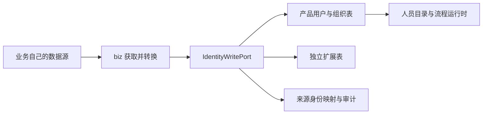

# 用户、组织标准写入与独立扩展

状态：已实现。biz 获取数据、转换为公共模型并主动调用 `IdentityWritePort`；框架负责保存。
没有增加取数 Provider、定时任务或后台重试，业务自行决定调用时机和失败后的处理方式。

## 1. 调用边界



| 模块 | 实现内容 |
| --- | --- |
| workflow-port | 公共写入/查询 Port、基础快照、扩展基类、注解、保存结果及异常 |
| workflow-admin | 来源授权、身份映射、事务写入、组织规则、扩展注册及通用持久化、管理 API |
| biz-project | 仅写基础用户/组织数据的主动调用示例 ProjectIdentityImporter |
| workflow-db-migrator | V126 框架迁移、原样保留已执行的 V127、新增 V128 清理历史示例表 |
| workflow-web | 通用扩展表单和用户、组织管理页接入 |

依赖方向为 biz → workflow-port，admin → workflow-port，由 workflow-app 装配。
公共模型不引用 Spring、MyBatis、Jackson 或 admin 实体。biz 不继承 SysUser / SysOrganization。
现有 IdentityDirectoryPort、IdentityMembershipPort 和最小 IdentityUser 查询模型保持各自用途。

## 2. biz 接入：配置、转换、调用

### 2.1 部署配置

下面是仓库中 `ProjectIdentityImporter` 对应的配置示例，需按实际部署填写服务账号。
配置只声明可信来源和授权清单，不会触发任何自动同步。

```yaml
workflow:
  identity:
    scan-packages:
      - com.workflow.biz
    sources:
      project-directory:
        write-permission: system:user:manage
        service-user-id: "实际服务用户的本地 ID"
        version-mode: VERSIONED
        extensions: []
```

- `scan-packages` 默认 `com.workflow.biz`，只扫描实际装配的模块；包外的扩展要显式加入扫描范围。
- 来源未配置、权限配置为空、操作者无权限或账号已停用时拒绝保存。
- 登录请求使用当前操作者；无请求上下文时使用显式配置的有效服务账号，并检查同样的权限。
- 服务账号还须拥有提交的每组扩展所声明的写权限。来源编码本身不是鉴权凭据。
- 上述示例复用已有 `system:user:manage` 权限，实际业务可配置独立权限，但须在产品权限体系中授予。

### 2.2 主动调用

业务先获取数据，在外部请求结束后调用产品能力，避免远程请求占用产品事务锁。
可以从业务 API、消息消费者或业务自己的其他入口调用，没有规定触发机制。

```java
// 注入公共 Port，不依赖 admin 的 Mapper、实体或 Service。
private final IdentityWritePort identities;

public IdentitySaveResult saveEmployee(ExternalEmployee employee) {
    return identities.saveUser(UserSaveModel.builder()
            .key(new ExternalIdentityKey("project-directory", employee.getId()))
            .sourceVersion(employee.getRevision())
            .base(UserBaseData.builder()
                    .account(employee.getLoginName())
                    .nickname(employee.getName())
                    .email(employee.getEmail())
                    .organizationExternalId(employee.getOrganizationId())
                    .departmentExternalId(employee.getDepartmentId())
                    .enabled(employee.isEnabled())
                    .build())
            .extensions(List.of())
            .build());
}
```

仓库内可编译示例：[ProjectIdentityImporter](../../workflow-server/biz-project/src/main/java/com/workflow/biz/project/identity/ProjectIdentityImporter.java)。
该类只接收 biz 已获取的快照，提供 `saveUser`、`saveOrganization`，不主动取数，默认不提交业务扩展。

组织须先写入，再写引用这些组织的用户。组织批量保存支持父子顺序打乱。
公共方法包括 `saveUser`、`saveOrganization`、`saveUsers`、`saveOrganizations`；批量必须同来源，每批 1～100 条。

## 3. 基础模型与身份规则

`ExternalIdentityKey(sourceCode, externalId)` 使用来源系统稳定且不复用的 ID，不能使用姓名或可修改账号定位。
对象类型由调用方法决定，用户和组织可以使用相同 externalId。外部键区分大小写。
当前是单目录部署；未来增加租户时必须把租户域纳入身份映射和授权，不能直接共享现有来源配置。

| 模型 | 字段 |
| --- | --- |
| UserSaveModel | key、sourceVersion、base、extensions |
| UserBaseData | account、nickname、email、phone、avatar、organizationExternalId、departmentExternalId、enabled |
| OrganizationSaveModel | key、sourceVersion、base、extensions |
| OrganizationBaseData | externalCode、name、type、parentExternalId、businessLevelCode、phone、email、address、description、sortOrder、enabled |

基础字段是本模型范围内的**完整快照**：可空字段传 null 会清空原值。
组织引用按当前 sourceCode 解析为外部 ID；null 表示无引用，根组织 parentExternalId 为 null。
首版不接受跨来源引用。用户仍使用现有单一 org/dept 归属，多组织任职通过职务领域维护。

- 新外部用户由框架生成稳定的本地 ID 和 `ext_<本地ID>` 用户名，外部 account 单独保存。
- 业务修改账号或姓名不会改变本地用户名，现有任务 assignee 和历史身份保持稳定。
- 本地组织编码也由框架生成，externalCode 保存在来源信息中，避免不同业务的编码冲突。
- 组织类型为 ORGANIZATION / DEPARTMENT；路径、层级、父子约束和业务层级复用现有组织服务。
- 负责人继续通过 UNIT_LEADER 任职入口维护，不在组织基础快照中设置。
- 来源对象被本地逻辑删除后，映射标记 RETIRED；再次提交相同键会拒绝，不静默重建。

外部预配账号使用 `EXTERNAL_ONLY`，不生成本地密码；本地密码登录、重置、改密、历史密码迁移均不能把它切换为密码账号。
保存身份资料不会自动授予登录凭据、角色或权限。外部登录仍需使用产品已有且经过授权的登录接入能力。
产品原有本地用户继续使用 LOCAL_PASSWORD。

## 4. 继承式扩展

### 4.1 新增一个扩展需要做什么

框架不预置具体业务扩展类，也不自动创建业务扩展表。不需要扩展时，直接保存基础数据即可。
需要时由业务自行定义类、提供建表迁移、确保所在模块被装配，无需单独编写 Mapper、Service、Controller 和表单。
以下类和 SQL 仅为接入说明示例，不随产品自动注册或执行。
继承负责表达类型，`@IdentityExtension` 提供识别和映射元数据；运行时不自动建表。

```java
@Data
@IdentityExtension(
    code = "hr.profile", title = "人事资料", table = "biz_hr_user_profile",
    readPermission = "hr:profile:view", writePermission = "hr:profile:manage")
public class HrUserExtension extends UserExtension {
    // 员工的学历资料，供业务筛选和展示使用，不参与产品用户身份定位。
    @ExtensionField(label = "学历", maxLength = 64)
    private String education;
}
```

新增更高版本 Flyway 迁移，建表结构例如：

```sql
CREATE TABLE biz_hr_user_profile (
    user_id VARCHAR(64) NOT NULL PRIMARY KEY,
    education VARCHAR(64) NULL,
    row_version BIGINT NOT NULL DEFAULT 0
);
```

组织扩展继承 `OrganizationExtension`，主键列改为 `organization_id`。
Java 字段默认驼峰转下划线，可用 `@ExtensionField(column = "...")` 显式指定列名。
每个实例字段都要声明 `@ExtensionField`；扩展类提供 public 无参构造方法。
主键及 row_version 由框架维护，不声明为业务字段。

启动时校验具体类型、扩展编码、字段、SQL 标识符、表的列集合和主键。
表名必须在 biz_ 命名空间；编码或表冲突、未声明字段、表不存在/不匹配时启动失败，须先执行迁移。
表的额外业务字段也必须有对应声明，防止通用写入遗漏资料。

控件依据类型生成，支持字符串、数值、Boolean、LocalDate、LocalDateTime、Instant；数值使用包装类型。
Long、BigDecimal 在浏览器中使用字符串传输和编辑，避免 JavaScript 数字精度丢失。
字符串可声明 `control = SELECT, options = {...}`。日期时间采用 ISO 格式，DATETIME 首版以 ISO 文本编辑。
集合、嵌套对象、任意 JSON、一对多子表、自定义复杂控件和 Java enum 字段不自动映射；选项使用稳定字符串值。

### 4.2 多组扩展和维护主权

同一用户可以关联多个不同扩展类，每个扩展使用自己的表。
注册键是“目标类型 + 扩展编码”，同一目标不能重复编码，同一表不能由多个声明维护。

| maintenance | 谁能写 | 产品管理页 |
| --- | --- | --- |
| LOCAL（默认） | 有权限的本地管理入口 | 可新增、编辑 |
| SOURCE | 来源允许清单内的 biz，且有该组写权限 | 只读 |

SOURCE 组必须在注解中显式指定 maintenance，并加入来源的 extensions 清单。
一个组内不混合两种主权。来源命令不能写 LOCAL 组，页面不能写 SOURCE 组。
写入命令的 extensions 为空列表表示不修改任何组；只携带一个组时，其他组保留原值。
携带的组按完整快照保存，组内 null 清空字段；重复组、未知字段、非法类型、必填/长度/选项错误会拒绝。

需要 SOURCE 资料时，由业务自行声明具体扩展类和表，再把扩展编码加入来源配置的 extensions 清单，并在写入时携带该对象。

用户和组织的同名编码属于不同目标，不冲突。禁用业务模块只停止注册和展示，保留表和已有数据。

### 4.3 biz 读取扩展

通过 `IdentityExtensionQueryPort` 按精确本地 ID 和已注册 Class 查询，缺失资料返回 Optional.empty()：

```java
profiles.findUserExtension(localUserId, HrUserExtension.class);
// 组织扩展定义并建表后，同样可通过 findOrganizationExtension 读取。
```

查询继续检查资料读权限及对象范围。查询身份目录不会自动加载所有业务资料。
同进程 biz 是可信代码；Java Port 不作为不可信插件的执行沙箱。

## 5. 页面新增、编辑

用户与组织管理页已接入 `IdentityExtensionForm`。新增基础数据时可同时添加 LOCAL 资料；编辑时自动读取已注册组。
查看用户时只读展示扩展。SOURCE 组显示“业务系统维护”，无写权限的组只读，无读权限的组不返回。
来源基础字段由服务端保护，管理页禁用这些字段，本地角色、LOCAL 扩展和本地启停可独立维护。

页面行为：

1. 读取 `GET /api/system/identity/extensions/schema?targetType=USER|ORGANIZATION` 获取有权查看的组和字段。
2. 已有记录读取 `GET /api/system/identity/extensions/{target}/{id}` 获取资料和 rowVersion。
3. 未建档的 LOCAL 组显示“添加资料”；未添加的组不产生空行。
4. 只提交改动的 LOCAL 组，作为原有用户/组织保存请求的 extensions 字段，与基础数据在同一事务保存。
5. 页面加载失败时阻止提交；切换目标时丢弃旧请求响应。并发版本冲突返回 409，需要重新加载。

本地提交示例（新组 expectedVersion 为 0，已有组使用读取的版本）：

```json
{
  "extensions": {
    "hr.profile": {
      "expectedVersion": 3,
      "data": { "education": "本科" }
    }
  }
}
```

本地资料按组使用乐观锁。没有组删除接口；清空允许为空的字段即可。
HTTP 不接受 Java 类名、表名或列名；SQL 标识符只来自启动白名单，值使用参数绑定。
除组权限外，扩展详情和编辑检查目标组织范围；管理员全域，其他用户按现有组织范围服务校验。

## 6. 保存、版本和事务

- VERSIONED（默认）：sourceVersion 必须为非负、可靠递增的来源版本。低版本返回 STALE_IGNORED，同版本同内容返回 UNCHANGED，同版本不同内容报 SOURCE_VERSION_CONFLICT。
- SERIAL：sourceVersion 必须为空，由 biz 保证同一对象的调用顺序；相同快照返回 UNCHANGED。框架无法识别无版本来源的乱序旧消息。
- 已有对象不能混用两种模式。摘要基于完整基础快照及本次携带的规范化扩展；同版本重试必须携带相同内容。
- 返回 IdentitySaveResult，包括 objectType、sourceCode、externalId、localId、canonicalUsername、outcome、appliedSourceVersion。
- 批量保存全部成功才提交，返回顺序与输入一致。IdentityWriteException 提供稳定 code/field；执行中失败通过 models[index] 定位。
- 基础、扩展、映射和必需审计一起提交；审计写入失败也回滚。单次失败直接抛回 biz，框架不隐式重试。

首版使用数据库事务内的目录行锁串行化身份写入，覆盖本地管理和来源写入，优先保证建树与首次创建一致性。
来源 Port 开启 READ_COMMITTED 事务，等待锁后读取最新已提交数据。
若 biz 已开启同库外层事务，必须同样使用 READ_COMMITTED，否则明确拒绝；建议完成外部取数后在业务事务外调用 Port。
参与已有合规事务时，最终提交或回滚由外层事务决定。无框架事务代理的手工 new 调用不受支持。

用户最终启用状态 = sourceEnabled && localAllowed。来源重新启用不能解除管理员的本地停用；
来源停用时管理员本地启用也不能使账号生效。用户转为停用时复用现有会话撤销能力。
来源状态和本地闸门单独保存在映射中，管理详情返回 sourceInfo 供页面区分。

## 7. 迁移与验证

业务扩展表由业务按需自行建表；已执行的历史迁移保留原文件，通过更高版本清理示例表：

- `V126__identity_source_write_and_external_accounts.sql`：认证模式、密码可空、目录锁、来源映射及密码字段元数据。
- `V127__project_identity_extension_examples.sql`：恢复并原样保留已执行的示例表迁移，确保 Flyway 历史校验一致。
- `V128__remove_project_identity_extension_examples.sql`：删除 V127 创建的三张示例表及表内数据，不影响其他自建扩展表。

V127 已执行，不能删除或改写；新库依次执行 V127、V128 后最终不保留这三张示例表。
已升级到 V127 的环境继续执行 V128。未改写 V001，未执行 flyway repair 或 baseline。
创建后续业务扩展前，重新检查 SQL/Java 迁移的最大版本，使用更高版本号。

新增验证覆盖同键并发创建、重复/乱序/冲突版本、完整快照清空、扩展组保留、整批/审计失败回滚、
本地扩展乐观锁、来源主权、组织批次排序和环、服务账号及权限拒绝、外部账号密码限制和 biz 转换示例。
前端模型测试覆盖未建档、修改检测、版本、只读组与字段验证；构建包含管理端和嵌入端。
集成测试使用 H2 MySQL 模式执行 V126 的兼容 SQL，不等同于已在真实部署 MySQL 上执行迁移验收。

### 本轮验证结果

- V128 清理迁移：两项 H2 MySQL 模式测试通过，覆盖已执行 V127 的升级、新库顺序执行、部分表已不存在和其他表保持原样。

- `mvn -o -pl workflow-admin -am test -DfailIfNoTests=false`：通过，admin 共 269 项测试。
- biz 主动转换示例测试：通过。
- 前端 `npm run test:unit`、`npm run build`、`npm run test:identity-extension:browser`：通过。
- 目标架构/授权检查 37 项中 36 项通过；`CrossModulePersistenceBoundaryTest` 因未改动的 migration/process 模块与旧基线不一致失败，本次未扩大基线。
- 全局可维护性检查仍有 98 个超限文件；未提高检查预算。
- 完整后端回归在既有 `ExcelListenersTest` 中发生 JVM 异常退出（134），因此不能宣称全量后端测试通过。
- 未连接部署数据库执行迁移，未启动实际业务取数。
