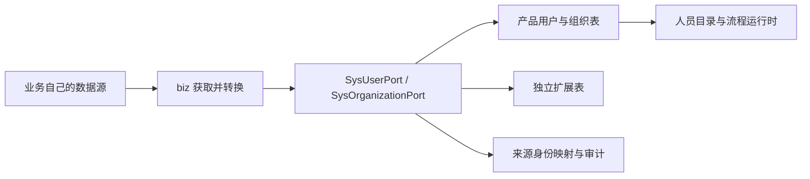

# 用户、组织标准写入与独立扩展

状态：已实现。biz 获取数据、转换为公共模型并主动调用 `SysUserPort` 或 `SysOrganizationPort`；框架负责保存。
主表文本扩展已在 V135 接入，用户、组织各有 ext1～ext5 五列，适合少量需要直接查询的来源字段。
没有增加取数 Provider、定时任务或后台重试，业务自行决定调用时机和失败后的处理方式。

原始 JSON 留存已实现，接入及状态规则见 [来源原始数据留存方案](identity-source-original-data-design.md)。

## 1. 调用边界



| 模块 | 实现内容 |
| --- | --- |
| workflow-port | 公共写入/查询 Port、基础快照、扩展基类、注解、保存结果及异常 |
| workflow-admin | 来源授权、身份映射、事务写入、组织规则、扩展注册及通用持久化、管理 API |
| biz-project | 转换基础资料和可选主表字段的主动调用示例 ProjectIdentityImporter |
| workflow-db-migrator | V126 框架迁移、V127/V128 历史示例表迁移、V129 乱序组织父链支持 |
| workflow-web | 通用扩展表单和用户、组织管理页接入 |

依赖方向为 biz → workflow-port，admin → workflow-port，由 workflow-app 装配。
公共模型不引用 Spring、MyBatis、Jackson 或 admin 实体。biz 不继承 SysUser / SysOrganization。
SysUserLookupPort、ProcessCandidateMemberPort 和最小 IdentityUser 查询模型保持各自用途。

## 2. biz 接入：配置、转换、调用

### 2.1 部署配置

下面是仓库中 `ProjectIdentityImporter` 对应的配置示例，需按实际部署填写服务账号。
配置只声明可信来源和授权清单，不会触发任何自动同步。

```yaml
workflow:
  identity:
    scan-packages:
      - com.workflow.biz
    sources:
      project-directory:
        permission-check-enabled: true
        write-permission: system:user:manage
        service-user-id: "实际服务用户的本地 ID"
        default-role-code: "employee" # 可选，使用角色管理中已存在且启用的角色编码
        version-mode: VERSIONED
        extensions: []
```

- `scan-packages` 默认 `com.workflow.biz`，只扫描实际装配的模块；包外的扩展要显式加入扫描范围。
- 来源必须显式登记，`permission-check-enabled` 默认 `true`，此时 `write-permission` 必填且操作者须具备该权限。
- 可信来源可设置 `permission-check-enabled: false`，此时可省略 `write-permission`，来源写权限校验会跳过。
- 登录请求使用当前操作者，无请求上下文时使用显式配置的服务账号，两种模式均校验账号有效性并记录操作人审计。
- `default-role-code` 为可选角色编码，省略或留空时新用户的初始角色为空。配置后，仅在该来源首次创建用户时分配对应角色，后续同步保留本地维护的角色集合。角色须已存在、未删除且已启用，否则报 `DEFAULT_ROLE_NOT_AVAILABLE`，用户创建及同批次写入一起回滚。
- 提交的每组扩展仍须在来源允许清单中，且操作者须拥有该组声明的写权限。来源编码本身不是鉴权凭据。
- 上述示例复用已有 `system:user:manage` 权限，实际业务可配置独立权限，但须在产品权限体系中授予。

### 2.2 主动调用

业务先获取数据，在外部请求结束后调用产品能力，避免远程请求占用产品事务锁。
可以从业务 API、消息消费者或业务自己的其他入口调用，没有规定触发机制。

```java
// 注入公共 Port，不依赖 admin 的 Mapper、实体或 Service。
private final SysUserPort users;

public IdentitySaveResult saveEmployee(ExternalEmployee employee) {
    return users.saveUser(UserSaveModel.builder()
            .key(new ExternalIdentityKey("project-directory", employee.getId()))
            .sourceVersion(employee.getRevision())
            .base(UserBaseData.builder()
                    .account(employee.getLoginName())
                    .nickname(employee.getName())
                    .email(employee.getEmail())
                    .organizationExternalId(employee.getOrganizationId())
                    .departmentExternalId(employee.getDepartmentId())
                    .enabled(employee.isEnabled())
                    .build())
            .extensions(List.of())
            .build());
}
```

仓库内可编译示例：[ProjectIdentityImporter](../../workflow-server/biz-project/src/main/java/com/workflow/biz/project/identity/ProjectIdentityImporter.java)。
该类只接收 biz 已获取的快照，提供 `saveUser`、`saveOrganization`，不主动取数，默认不提交业务扩展。

组织支持单条、跨批次乱序写入。父级尚未到达时保存基础资料及同来源父级外部引用，
`hierarchyReady=false`，`path/level` 为空，组织树暂时隐藏该节点及其未完整的下级。
父级到达后，在同一目录事务中自动补齐关联并重算受影响子树的路径、层级，包括已有本地下级。
父链尚未补齐的组织无法参与要求完整父链的流程人员解析。自引用、跨调用循环父链及非法父子类型会拒绝并回滚本次写入。
用户引用的组织仍须先存在，组织批量保存允许父级不在本批。
公共方法包括 `saveUser`、`saveOrganization`、`saveUsers`、`saveOrganizations`；批量必须同来源，每批 1～100 条。

## 3. 基础模型与身份规则

`ExternalIdentityKey(sourceCode, externalId)` 使用来源系统稳定且不复用的 ID，不能使用姓名或可修改账号定位。
对象类型由调用方法决定，用户和组织可以使用相同 externalId。外部键区分大小写。
当前是单目录部署；未来增加租户时必须把租户域纳入身份映射和授权，不能直接共享现有来源配置。

| 模型 | 字段 |
| --- | --- |
| UserSaveModel | key、sourceVersion、base、extensions、rawDataJson、mainFields、bindingChange |
| UserBaseData | account、nickname、email、phone、avatar、organizationExternalId、departmentExternalId、enabled |
| OrganizationSaveModel | key、sourceVersion、base、extensions、rawDataJson、mainFields、bindingChange |
| OrganizationBaseData | externalCode、name、type、parentExternalId、businessLevelCode、phone、email、address、description、sortOrder、enabled |

基础字段是本模型范围内的**完整快照**：可空字段传 null 会清空原值。
组织引用按当前 sourceCode 解析为外部 ID；null 表示无引用，根组织 parentExternalId 为 null。
首版不接受跨来源引用。用户仍使用现有单一 org/dept 归属，多组织任职通过职务领域维护。

V129 为来源映射保存 `parent_external_id` 与精确哈希 `parent_source_key`，后者支持后到父级的定点查询，
避免数据库大小写不敏感的默认排序规则误关联。历史组织默认父链已完整，迁移从已有父子关系回填来源父级引用。

- 外部用户的本地 ID 由框架生成，`username` 原样使用传入的 `account`。创建和更新时 `account` 均必填，最多 50 字符，并在所有来源及本地用户中全局唯一。
- 组织的 `orgCode` 原样使用传入的 `externalCode`，创建和更新时均必填且最多 100 字符，并在所有来源及本地组织中全局唯一。两类编码均按输入保存大小写和空格。
- 编码占用检查沿用目标数据库列的比较规则，包含逻辑删除记录；冲突返回 `IDENTITY_CODE_CONFLICT`，由调用方协调来源数据。
- 用户账号和组织编码创建后固定。已有来源对象提交新版本且改变 `account` / `externalCode` 时返回 `SOURCE_CODE_IMMUTABLE`，整次写入回滚；旧版本忽略和同版本冲突仍按第 6 节处理。姓名及其他资料可随来源快照更新。
- 各环境独立同步相同来源快照时，来源身份键、用户名和组织编码一致，流程配置可按用户名或组织编码解析为目标环境本地 ID。本地 ID 及组织路径仍由各环境生成。
- 组织类型为 ORGANIZATION / DEPARTMENT；路径、层级、父子约束和业务层级复用现有组织服务。
- 负责人继续通过 UNIT_LEADER 任职入口维护，不在组织基础快照中设置。
- 来源对象被本地逻辑删除后，映射标记 RETIRED；再次提交相同键会拒绝，不静默重建。

外部预配账号初始使用 `EXTERNAL_ONLY`，不生成本地密码。拥有 `system:user:reset-password` 权限的用户或超级管理员可在用户管理中为该账号设定临时密码，认证模式随之切换为 `EXTERNAL_AND_LOCAL_PASSWORD`。重置会撤销现有会话，账号须在下次本地登录后先改密。
外部来源绑定、资料同步和来源键修复继续按外部预配账号处理。普通资料保存、来源同步和历史密码迁移都不能为仅外部认证的账号开通本地密码登录。
来源配置 `default-role-code` 时，首次创建用户会同时分配该角色，获得该角色对应的权限。用户及组织同步共用来源配置，默认角色只用于新建用户。
外部登录仍需使用产品已有且经过授权的登录接入能力。
产品原有本地用户继续使用 LOCAL_PASSWORD。

### 来源外部 ID 修复

在单条或批量保存模型中传入新的 `key`、完整来源快照和可选的 `bindingChange`。数据修复任务先核实本地 ID 与来源对象的对应关系。

| 场景 | `bindingChange` | 写入结果 |
| --- | --- | --- |
| 旧绑定仍存在 | `new IdentityBindingChange(localId, oldExternalId)` | 迁移同来源的旧绑定、原文和来源组织的父级引用，保留本地 ID、已有版本记录及本地启用许可。 |
| 旧绑定已删除 | `new IdentityBindingChange(localId, null)` | 为尚未绑定的本地记录补绑，以本次快照建立来源版本基线。已停用的本地记录继续停用。 |

来源账号或组织编码须与本地记录精确一致，用户须为外部预配账号，包括已开通本地密码的外部账号。修复操作人须通过来源授权及对应的 `system:user:manage` 或 `system:organization:manage` 权限校验，交互操作还校验本地对象的数据范围。其他对象占用的新键、已退休的旧绑定及目标键下归属不明的原文会阻止修复。成功修复返回 `UPDATED`，重复提交继续按来源版本和摘要判定。

组织换键前，来源方须切换下级组织和用户的组织引用，并处理仍携带旧键的待重试消息。仅因引用切换而改变内容的版本化快照也应提交更高版本。先删绑定会失去旧键与本地对象的关联，补绑据本次快照恢复，旧键下的原文及下级来源引用需要另外核对。批量处理组织与用户时先提交组织。

### 3.1 主表文本扩展（V135）

`sys_user` 和 `sys_organization` 各增加 `ext1`～`ext5` 五个可空文本列，每列最多 500 字符、默认 NULL。业务明确选择外部字段并转换成字符串后，通过公共 `IdentityMainFields` 提交；不从 `rawDataJson` 自动解析字段，不需要独立业务扩展表。列的用途及格式由接入业务约定，同一部署须保持一致，原始 JSON 留存能力继续独立工作。

```java
identities.saveUser(UserSaveModel.builder()
        .key(new ExternalIdentityKey("project-directory", employee.getId()))
        .sourceVersion(employee.getRevision())
        .base(baseData)
        .mainFields(IdentityMainFields.builder()
                .ext1(employee.getEmployeeNo())  // 保留前导零，供业务按员工编号关联。
                .ext2(employee.getEmployeeType()) // 使用稳定类别编码，供主表条件查询。
                .ext3(employee.getCostCenterCode())
                .build())
        .rawDataJson(originalRecordJson)
        .build());
```

`UserSaveModel` 和 `OrganizationSaveModel` 的构造方法也支持在 `rawDataJson` 后依次传入 `ext1`～`ext5`，模型会将五个值封装成 `mainFields`。使用这个重载时，五个值均为 `null` 表示清空整组。

调用 `ProjectIdentityImporter` 时，可以把映射结果放入 `DirectoryUser` 或 `DirectoryOrganization` 快照，由常用保存入口随基础资料提交。三参数重载也可显式指定本次提交的字段组。旧快照构造方法默认省略该组，旧保存模型构造方法和 Builder 调用继续可用。

- `mainFields == null` 表示未提供，保留已有五列；新对象默认五列均为 NULL。
- 携带本组时完整替换五列，组内 null 真实清空对应列，不能只填 ext1 而期望其他四列自动保留。五项均为 null 表示清空整组。
- 原样保存字符串，不 trim、不推断数字或日期，不丢弃前导零；Oracle 兼容库按数据库规则将空字符串存为 NULL。
- 单条、批量入口均按字符数校验五列，每项最多 500 字符，超长错误定位到 `mainFields.extN` 或批次对应路径。
- 只有携带的 `mainFields` 参与本次业务摘要，省略时保留原摘要算法，历史调用不会因升级误报冲突。VERSIONED 的同版本同内容幂等、同版本不同内容冲突、旧版本忽略规则同时覆盖该组；重复请求须保留相同的携带方式。既有版本首次补充主表字段须提升来源版本，SERIAL 模式仍按调用顺序更新。
- 主表字段与基础资料、独立扩展、来源映射、原文和必需审计共用事务，任意失败整次回滚；组织父级后到重算派生结构时保留主表扩展列。
- 管理实体返回五列，普通管理请求不接受修改，由来源同步维护。业务查询可直接使用列或 `SysUser::getExt1` / `SysOrganization::getExt1` 等 Mapper 条件，不需要解析 JSON；本次不增加通用界面编辑器、列表筛选参数、索引、唯一约束或外键。索引及具体筛选由业务按实际用途添加。
- 旧数据保持 NULL，通过下一次有效同步补齐；不从可能已过期的原文自动回填。

## 4. 继承式扩展

### 4.1 新增一个扩展需要做什么

框架不预置具体业务扩展类，也不自动创建业务扩展表。不需要扩展时，直接保存基础数据即可。
需要时由业务自行定义类、提供建表迁移、确保所在模块被装配，无需单独编写 Mapper、Service、Controller 和表单。
以下类和 SQL 仅为接入说明示例，不随产品自动注册或执行。
继承负责表达类型，`@IdentityExtension` 提供识别和映射元数据；运行时不自动建表。

```java
@Data
@IdentityExtension(
    code = "hr.profile", title = "人事资料", table = "biz_hr_user_profile",
    readPermission = "hr:profile:view", writePermission = "hr:profile:manage")
public class HrUserExtension extends UserExtension {
    // 员工的学历资料，供业务筛选和展示使用，不参与产品用户身份定位。
    @ExtensionField(label = "学历", maxLength = 64)
    private String education;
}
```

新增更高版本 Flyway 迁移，建表结构例如：

```sql
CREATE TABLE biz_hr_user_profile (
    user_id VARCHAR(64) NOT NULL PRIMARY KEY,
    education VARCHAR(64) NULL,
    row_version BIGINT NOT NULL DEFAULT 0
);
```

组织扩展继承 `OrganizationExtension`，主键列改为 `organization_id`。
Java 字段默认驼峰转下划线，可用 `@ExtensionField(column = "...")` 显式指定列名。
每个实例字段都要声明 `@ExtensionField`；扩展类提供 public 无参构造方法。
主键及 row_version 由框架维护，不声明为业务字段。

启动时校验具体类型、扩展编码、字段、SQL 标识符、表的列集合和主键。
表名必须在 biz_ 命名空间；编码或表冲突、未声明字段、表不存在/不匹配时启动失败，须先执行迁移。
表的额外业务字段也必须有对应声明，防止通用写入遗漏资料。

控件依据类型生成，支持字符串、数值、Boolean、LocalDate、LocalDateTime、Instant；数值使用包装类型。
Long、BigDecimal 在浏览器中使用字符串传输和编辑，避免 JavaScript 数字精度丢失。
字符串可声明 `control = SELECT, options = {...}`。日期时间采用 ISO 格式，DATETIME 首版以 ISO 文本编辑。
集合、嵌套对象、任意 JSON、一对多子表、自定义复杂控件和 Java enum 字段不自动映射；选项使用稳定字符串值。

### 4.2 多组扩展和维护主权

同一用户可以关联多个不同扩展类，每个扩展使用自己的表。
注册键是“目标类型 + 扩展编码”，同一目标不能重复编码，同一表不能由多个声明维护。

| maintenance | 谁能写 | 产品管理页 |
| --- | --- | --- |
| LOCAL（默认） | 有权限的本地管理入口 | 可新增、编辑 |
| SOURCE | 来源允许清单内的 biz，且有该组写权限 | 只读 |

SOURCE 组必须在注解中显式指定 maintenance，并加入来源的 extensions 清单。
一个组内不混合两种主权。来源命令不能写 LOCAL 组，页面不能写 SOURCE 组。
写入命令的 extensions 为空列表表示不修改任何组；只携带一个组时，其他组保留原值。
携带的组按完整快照保存，组内 null 清空字段；重复组、未知字段、非法类型、必填/长度/选项错误会拒绝。

需要 SOURCE 资料时，由业务自行声明具体扩展类和表，再把扩展编码加入来源配置的 extensions 清单，并在写入时携带该对象。

用户和组织的同名编码属于不同目标，不冲突。禁用业务模块只停止注册和展示，保留表和已有数据。

### 4.3 biz 读取扩展

通过 `SysUserPort` 或 `SysOrganizationPort` 按精确本地 ID 和已注册 Class 查询，缺失资料返回 Optional.empty()：

```java
users.findUserExtension(localUserId, HrUserExtension.class);
// 组织扩展定义并建表后，同样可通过 findOrganizationExtension 读取。
```

查询继续检查资料读权限及对象范围。查询身份目录不会自动加载所有业务资料。
同进程 biz 是可信代码；Java Port 不作为不可信插件的执行沙箱。

## 5. 页面新增、编辑

用户与组织管理页已接入 `IdentityExtensionForm`。新增基础数据时可同时添加 LOCAL 资料；编辑时自动读取已注册组。
查看用户时只读展示扩展。SOURCE 组显示“业务系统维护”，无写权限的组只读，无读权限的组不返回。
来源基础字段由服务端保护，管理页禁用这些字段，本地角色、LOCAL 扩展和本地启停可独立维护。

页面行为：

1. 读取 `GET /api/system/identity/extensions/schema?targetType=USER|ORGANIZATION` 获取有权查看的组和字段。
2. 已有记录读取 `GET /api/system/identity/extensions/{target}/{id}` 获取资料和 rowVersion。
3. 未建档的 LOCAL 组显示“添加资料”；未添加的组不产生空行。
4. 只提交改动的 LOCAL 组，作为原有用户/组织保存请求的 extensions 字段，与基础数据在同一事务保存。
5. 页面加载失败时阻止提交；切换目标时丢弃旧请求响应。并发版本冲突返回 409，需要重新加载。

本地提交示例（新组 expectedVersion 为 0，已有组使用读取的版本）：

```json
{
  "extensions": {
    "hr.profile": {
      "expectedVersion": 3,
      "data": { "education": "本科" }
    }
  }
}
```

本地资料按组使用乐观锁。没有组删除接口；清空允许为空的字段即可。
HTTP 不接受 Java 类名、表名或列名；SQL 标识符只来自启动白名单，值使用参数绑定。
除组权限外，扩展详情和编辑检查目标组织范围；管理员全域，其他用户按现有组织范围服务校验。

## 6. 保存、版本和事务

- VERSIONED（默认）：sourceVersion 必须为非负、可靠递增的来源版本。低版本返回 STALE_IGNORED，同版本同内容返回 UNCHANGED，同版本不同内容报 SOURCE_VERSION_CONFLICT。
- SERIAL：sourceVersion 必须为空，由 biz 保证同一对象的调用顺序；相同快照返回 UNCHANGED。框架无法识别无版本来源的乱序旧消息。
- 已有对象不能混用两种模式。摘要基于完整基础快照及本次携带的规范化扩展；同版本重试必须携带相同内容。
- 返回 IdentitySaveResult，包括 objectType、sourceCode、externalId、localId、canonicalUsername、outcome、appliedSourceVersion。
- 批量保存全部成功才提交，返回顺序与输入一致。IdentityWriteException 提供稳定 code/field；执行中失败通过 models[index] 定位。
- 基础、扩展、映射、新用户默认角色和必需审计一起提交，审计写入失败也回滚。单次失败直接抛回 biz，框架不隐式重试。

首版使用数据库事务内的目录行锁串行化身份写入，覆盖本地管理和来源写入，优先保证建树与首次创建一致性。
来源 Port 开启 READ_COMMITTED 事务，等待锁后读取最新已提交数据。
若 biz 已开启同库外层事务，必须同样使用 READ_COMMITTED，否则明确拒绝；建议完成外部取数后在业务事务外调用 Port。
参与已有合规事务时，最终提交或回滚由外层事务决定。无框架事务代理的手工 new 调用不受支持。

用户最终启用状态 = sourceEnabled && localAllowed。来源重新启用不能解除管理员的本地停用；
来源停用时管理员本地启用也不能使账号生效。用户转为停用时复用现有会话撤销能力。
来源状态和本地闸门单独保存在映射中，管理详情返回 sourceInfo 供页面区分。

## 7. 迁移与验证

业务扩展表由业务按需自行建表，框架结构随版本迁移演进。

- `V126__identity_source_write_and_external_accounts.sql`：认证模式、密码可空、目录锁、来源映射及密码字段元数据。
- `V127__project_identity_extension_examples.sql`：恢复并原样保留已执行的示例表迁移，确保 Flyway 历史校验一致。
- `V128__remove_project_identity_extension_examples.sql`：删除 V127 创建的三张示例表及表内数据，不影响其他自建扩展表。
- `V129__allow_out_of_order_organization_provisioning.java` 增加组织父链就绪状态、来源父级引用及查询索引，并回填已有同来源父子引用。
- `V131__identity_source_snapshot.java`：来源身份最新原文快照，每个来源对象仅保存一份。应用部署前执行至 V131。

MySQL 存量库也可直接执行 [V131 手工升级 SQL](../sql/upgrade/mysql/V131__identity_source_snapshot.sql)。它与原 Java 迁移等价，支持重复执行；原历史迁移保留，后续 Flyway 可正常登记版本。操作及状态查询方法见 [SQL 说明](../sql/README.md#2026-11-12-补充-v131-mysql-手工升级脚本)。

V127 已执行，不能删除或改写；新库依次执行 V127、V128 后最终不保留这三张示例表。
已升级到 V127 的环境依次执行 V128、V129，应用升级前须完成 V129。
创建后续业务扩展前，重新检查 SQL/Java 迁移的最大版本，使用更高版本号。

新增验证覆盖同键并发创建、重复/乱序/冲突版本、完整快照清空、扩展组保留、整批/审计失败回滚、
本地扩展乐观锁、来源主权、组织批次排序和环、服务账号及权限拒绝、外部账号重置后本地登录及来源同步、biz 转换示例。
前端模型测试覆盖未建档、修改检测、版本、只读组与字段验证；构建包含管理端和嵌入端。
集成测试使用 H2 MySQL 模式执行 V126 的兼容 SQL，不等同于已在真实部署 MySQL 上执行迁移验收。
乱序组织回归使用真实组织服务及 Mapper，覆盖跨调用和跨批次补齐、父子并发写入、待关联父级版本变更、
整棵子树路径与层级重算、循环与类型拒绝、审计失败回滚、本地状态更新兼容和精确来源匹配。
V129 测试直接执行实际 Java 迁移，并通过 Flyway 验证空结构升级、历史回填及重复执行。

### 本轮验证结果

- V128 清理迁移：两项 H2 MySQL 模式测试通过，覆盖已执行 V127 的升级、新库顺序执行、部分表已不存在和其他表保持原样。

- `mvn -o -pl workflow-admin -am test -DfailIfNoTests=false`：通过，admin 共 269 项测试。
- biz 主动转换示例测试：通过。
- 前端 `npm run test:unit`、`npm run build`、`npm run test:identity-extension:browser`：通过。
- 目标架构/授权检查 37 项中 36 项通过；`CrossModulePersistenceBoundaryTest` 因未改动的 migration/process 模块与旧基线不一致失败，本次未扩大基线。
- 全局可维护性检查仍有 98 个超限文件；未提高检查预算。
- 完整后端回归在既有 `ExcelListenersTest` 中发生 JVM 异常退出（134），因此不能宣称全量后端测试通过。
- 未连接部署数据库执行迁移，未启动实际业务取数。
