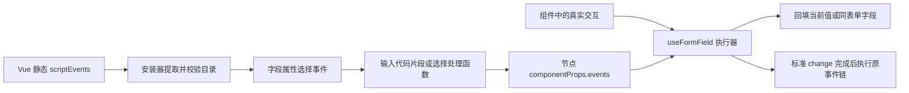

# 组件自声明前端事件：实现与接入说明

> 路径与命令：本文的 `workflow-web/`、`workflow-mobile/`、`packages/`、`extensions/` 和前端 `scripts/` 相对 `workflow-frontend/`；前端 npm/Node 命令从该工作区执行。`workflow-server/`、`docs/`、`deploy/` 仍相对仓库根目录。

状态：已实现。处理函数通过下拉选择已注册的名称和版本；代码片段直接输入函数体。实际文本组件位于 `workflow-web/src/extensions/builtin/fields/components/TextField.vue`，配套完整示例位于 `docs/examples/TextField.component-events.example.vue`。

## 事件如何流转



前端事件目录是 `capabilities.scriptEvents`，由组件派生。原有 `capabilities.supportedEvents` 仍表示后台事件链能力，两者没有互相转换的关系。

## 1. 在组件中声明事件

在 `<script setup>` 中使用静态选项：

```js
defineOptions({
  name: 'AddressRecognitionField',
  scriptEvents: [{
    name: 'onRecognizeSuccess',
    label: '识别成功',
    description: '组件完成地址识别后触发',
    parameters: [
      { name: 'address', type: 'string', required: true, description: '识别后的完整地址' }
    ]
  }]
})
```

- `name` 必须符合 `^on[A-Z][A-Za-z0-9]*$`，同一组件内不能重复。
- `label` 为设计器显示名称；`description` 说明真实触发时机。
- `parameters` 描述 `event.data`，类型支持 string / number / boolean / object / array / any，默认可选。
- `variants` 可限定组件共用实现时的规范注册名。例如 TextField 的 `onClear` 只声明给 `input/password`，不给 `textarea`。
- `scriptEvents: []` 表示明确没有事件；未声明的旧组件保留兼容协议。

`defineOptions` 编译后成为组件选项对象，安装器读取 `implementation.scriptEvents`，不读取 `.vue` 源码、不挂载组件，也不调用 setup。普通 setup 局部变量和 `defineExpose` 不作为能力目录。

验证记录：使用当前 Vue 编译插件和 Vite 8.1.5，对真实 TextField 进行 production 压缩构建，再导入生成的 JS，测试验证事件名、variants、parameters 均保留。对应测试为 `workflow-web/src/extensions/__tests__/component-script-events.spec.mjs`。若未来改成异步加载，必须先解析模块并取真实组件导出，再安装；不能读取尚未解析的异步包装器。

组件 manifest 不再重复填写事件列表。安装器从组件提取声明，注册描述和扩展目录共用这份数据。修改组件源码会触发开发环境整页重载，使事件目录同步刷新。

## 2. 在真实交互处触发

```js
const { fieldValue, triggerScriptEvent } = useFormField(props, emit)

async function onAddressRecognized(address) {
  fieldValue.value = address
  const result = await triggerScriptEvent('onRecognizeSuccess', {
    value: address,
    data: { address }
  })
  // 如业务还需要进入标准值变化链，再使用 handleChange(result.value)。
  // 仅在 result.current 时继续，避免新输入后执行旧事件链。
}
```

`triggerScriptEvent(name, { value?, selection?, data? })` 检查组件声明和参数，读取当前字段绑定，执行处理器并报告异常，返回 `Promise<{ current, value }>`。传入的 value 只是本次快照，不自动更新模型；省略时取最新本地值。此调用不会自行发出宿主 change，也不会调用后台事件链。

`handleChange` 负责标准 onChange 脚本完成后的宿主 change。`handleInput` 只执行输入脚本。`handleSelectionChange` 保持实体字段 value 为 ID、selection 为记录，脚本改选或清空后不会继续携带旧记录回填。

函数上下文与代码片段变量一致：

| 名称 | 用途 |
| --- | --- |
| value | 本次处理器开始时的值快照 |
| field | 字段配置快照，直接修改它不会修改真实配置 |
| selection | 实体选中记录或记录数组；清空时为 null |
| event.name | 当前声明中的事件名 |
| event.data | 组件传入的普通 JSON 数据，按声明校验类型 |
| setValue(value) | 回填当前字段，同批次后续事件读取更新后的值 |
| getFieldValue(code) | 读取当前表单/子表行的字段 |
| setFieldValue(code, value) | 回填当前作用域字段，不递归执行目标字段脚本 |

支持 await，异步等待最长 5 秒；超时、新输入、只读、禁用、卸载后的 helper 写入被阻止。返回值不自动回填。脚本仍运行在浏览器页面中，超时不能抢占同步死循环；嵌入页面沿用禁用前端脚本的限制。

## 3. 处理函数通过下拉选择

处理函数写在受构建管理的 JS 模块中，接收一个上下文对象：

```js
/** 只处理字符串，通过 helper 回填，不依赖 window 上的函数名称。 */
export async function trimCustomerName({ value, setValue }) {
  if (typeof value === 'string') setValue(value.trim())
}
```

为它新增 `FIELD_EVENT_HANDLER` 清单，例如 `extensions/manifests/biz-customer/handlers/trim_name.v1.extension.json`：

```json
{
  "$schema": "../../../schemas/extension.schema.json",
  "schemaVersion": 1,
  "type": "FIELD_EVENT_HANDLER",
  "name": "customer.trimName",
  "label": "整理客户名称",
  "description": "去除客户名称首尾空格",
  "version": 1,
  "implementation": {
    "package": "@flow/biz-customer/pc/handlers/trimName",
    "export": "trimCustomerName",
    "kind": "FUNCTION"
  },
  "metadata": {
    "supportedFieldTypes": ["STRING"],
    "capabilities": { "eventNames": ["onChange", "onBlur"] }
  }
}
```

清单类型对应 `registerFieldEventHandler`，安装阶段不会执行函数。字段类型和 eventNames 为空时不限制范围。下拉框按范围筛选，保存精确版本，不回退最新版本；缺失或不适用的引用显示错误。发布后需要改变处理语义时新增版本，保留旧实现。

本次提供两个公共函数：`trimText@1`（去除首尾空格）和 `trimTextOnEnter@1`（非输入法组词的 Enter 时去除首尾空格）。它们在扩展管理中作为构建项展示。移动实现通过 manifest 的 `platforms.mobile` 单独注册，遵循现有跨端扩展规则。

## 4. 字段保存格式

代码片段直接输入，例如 `setValue(String(value ?? '').trim())`。编辑器保存以下 JSON：

```json
{
  "events": {
    "onChange": { "mode": "body", "code": "setValue(String(value ?? '').trim())" },
    "onKeydown": { "mode": "function", "handler": "trimTextOnEnter", "version": 1 }
  }
}
```

该 JSON 在字段 componentProps 内，持久化至 `entity_form_node.props_document`，随节点复制、保存和发布进入配置快照。不存 JavaScript 函数对象，也不把函数表达式作为“处理函数”模式输入。

旧字符串绑定仍按代码片段执行。`eventOnChange` 等根草稿覆盖持久化副本，包括显式清空；读取和序列化统一使用 `readFieldScripts/writeFieldScripts`，不会把对象引用当字符串过滤掉。

编辑器仅展示组件声明的事件。未知旧绑定保留原文并标注，允许保存草稿；发布前必须移除或换回支持它的组件。已有字符串绑定保留原监听兼容路径，新结构化绑定和组件主动触发必须匹配声明。保存时只做语法/注册引用校验，不执行用户代码。

PC 设计器发布前核对实际解析的组件、版本、声明及函数引用。后端保存、导入和发布时验证事件 JSON 形状；后端不执行 Vue，也不代替对应前端构建解析函数。自定义组件目录能力副本随原有纳管同步流程更新，单改 Vue 不会自动更新数据库中的目录记录。

## 5. TextField 的改造

- 静态声明 onInput、onChange、onFocus、onBlur、onClear、onKeydown，并保留实际可用的鼠标、keyup 和输入法组合事件。
- 保留 textarea、密码遮蔽、字数限制、行数、只读等展示行为。
- `@clear` 接入共享适配器；keydown 提取 key/code/isComposing 和修饰键，不传 DOM Event。
- 使用 `useFormField(props, emit, { eventAdapter: 'text' })`。

Element Plus 清空会在一个调用栈中发出 `update:modelValue → change → clear → input`。适配器先即时同步模型，再合并同栈通知，按以下顺序执行：

```text
onClear → onInput → onChange → 宿主 change（一次）→ 同批次 onBlur
```

clear 第一步收到空字符串，后续步骤读取 helper 更新后的值。新输入立即使旧异步批次失效，不排在旧任务后等待。处理器内部 setValue 不被当成新用户输入。

非文本示例是 `ProjectAcceptanceScoreField.vue`：声明 `onScoreCommit`，在提交评分时传 `{ score }`，完成后进入标准 change。PC 与移动评分组件分别声明并触发，编辑器无评分事件专属代码。

其它预置组件也声明了自己实际接入的事件：数字/实体选择为变化和焦点事件，选择/日期/级联包含真实面板事件，单选/多选/开关/附件/富文本/子表单提供值变化事件，展示组件明确为空。

## 6. 跨端与验证

移动端从自己的组件实现声明能力，不把 PC 的 DOM 按键、鼠标或清空能力直接复制过去。共享的代码片段/函数引用执行器可在移动表单使用，具体事件是否可触发仍取决于移动组件声明和真实接入点；移动表单会显示不支持的事件及缺失函数提示。当前设计器事件目录与发布预检针对 PC 实现；未建立跨端发布能力矩阵，PC 专属交互不能当作两端共同业务规则。

验证入口：

```sh
npm run build:packages
node workflow-web/src/shared/__tests__/field-event-scripts.spec.js
node workflow-web/src/shared/__tests__/component-script-events.spec.js
npm run test:extensions --workspace workflow-web
npm run test:designer-models --workspace workflow-web
npm run test:field-scripts:browser --workspace workflow-web
npm run build --workspace workflow-web
npm run build --workspace workflow-mobile
```

后端针对性测试：在 workflow-server 运行 `mvn -pl workflow-entity -am -Dtest=EntityFormNodePropertyPolicyTest -Dsurefire.failIfNoSpecifiedTests=false test`。

验证结果（2026-10-15）：共享包 62 项、移动端 25 项、扩展 15 项、设计器模型 10 项和后端节点属性 15 项测试通过；新旧事件执行器测试、真实浏览器验收以及 PC/Embed/移动端构建通过。浏览器验收包含真实自定义评分事件、函数选择和执行、异步清空、输入法参数、保存重开、未知旧绑定提示和嵌入禁用。全仓可维护性行数预算检查存在 98 项超限；使用修改前 HEAD 内容核对仍为 98 项，本次未调整预算。

数据库迁移：新增无、修改无、删除无；使用原有 JSON 文档列。
