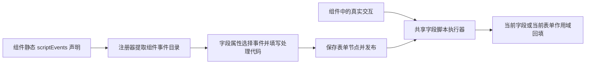

# 组件自声明前端事件方案与 TextField 改造示例

状态：设计方案，运行代码尚未改造。配套示例为 `docs/examples/TextField.component-events.example.vue`；示例使用拟新增的运行 API，不能直接替换当前组件运行。

## 目标与职责

组件开发者在组件中声明支持的事件，并在正确的交互位置触发。表单配置者在字段属性中选择这些事件，填写代码片段或处理函数。系统负责读取声明、保存字段绑定、执行脚本和显示错误。预置组件与自定义组件遵循同一协议。



本期范围是组件前端事件。现有后台事件链的 `supportedEvents` 含义保持独立；`onChange` 完成后继续沿用现有 `FIELD_CHANGE` 链路。不增加全局事件总线，也不要求用户另写事件触发代码。

## 1. 事件声明直接归组件所有

建议用 Vue 的静态自定义选项承载声明：

```js
defineOptions({
  name: 'AddressRecognitionField',
  scriptEvents: [
    {
      name: 'onRecognizeSuccess',
      label: '识别成功',
      description: '组件完成地址识别后触发',
      parameters: [
        { name: 'address', type: 'string', description: '识别后的完整地址' }
      ]
    }
  ]
});
```

`scriptEvents` 是拟新增的项目约定。Vue 允许保留此类组件选项，但当前注册器、设计器和运行时还不会消费它，必须一起改造。

| 属性 | 约束与用途 |
| --- | --- |
| `name` | 稳定事件名，例如 `onClear`；同一组件中唯一，沿用 `^on[A-Z][A-Za-z0-9]*$` 命名规则 |
| `label` | 表单设计器显示的中文名称 |
| `description` | 说明真实触发时机，以及哪些操作不会触发 |
| `parameters` | `event.data` 中的参数说明，用于编辑器提示和运行时参数形状校验；只传普通数据 |
| `variants` | 可选：组件复用多个注册名称时，限定适用的规范组件名；缺省表示全部变体 |

例如 TextField 同时用于 `input`、`password`、`textarea`，它的 `onClear` 声明使用 `variants: ['input', 'password']`。注册器按实际注册名称过滤，`string/text` 等历史别名先归一到对应注册名称。不能直接用实体 `fieldType` 猜测事件能力，因为同一字段可能实际渲染为实体选择器或自定义组件。

声明只能包含可序列化的元数据，不能执行用户脚本或依赖组件实例。声明本身不会产生事件，组件还必须有对应的触发调用。

## 2. 单一声明来源与存储位置

| 内容 | 来源与保存位置 |
| --- | --- |
| 组件支持哪些事件 | `.vue` 的 `defineOptions({ scriptEvents })`，跟组件代码和版本一起维护 |
| 设计器使用的事件目录 | 安装器从组件对象读取并验证声明，投影到注册描述与目录的 `capabilities.scriptEvents`；这是派生数据 |
| 纳管自定义组件的能力副本 | 如需要后端展示、发布核对，随现有扩展配置同步到 `ui_extension_definition.capabilities_document` 的 `scriptEvents` 属性；无需额外事件表 |
| 预置组件的声明 | 沿用当前构建注册模式，不要求为了事件强行新增数据库扩展记录 |
| 当前字段的事件代码 | 保存到表单节点的 `entity_form_node.props_document`，路径为 `componentProps.events`；随表单保存、发布进入运行快照 |

manifest 继续负责组件名称、版本、实现路径等注册信息，事件列表不在 manifest 再维护一份。组件管理页可展示派生声明，不能通过修改数据库能力副本凭空增加组件事件。

现在 `installer.js` 的注册 metadata 与 `publish(plan.map(item => item.entry))` 是两条投影路径。改造时必须让两者使用同一份提取后的声明，否则会出现运行时认识事件、管理页看不到的情况。后端纳管副本应随组件注册或更新明确同步；仅修改 `.vue` 不意味着数据库自动同步。

事件声明按具体组件版本读取。版本引用必须解析到相同实现和描述，避免设计器使用新事件、运行时仍加载旧组件。

## 3. 表单配置界面

字段属性里的“前端脚本事件”读取实际组件的声明，展示中文名称、事件编码、触发说明、参数说明以及配置状态。

```text
组件：文本输入

输入中    onInput     未配置
值变化    onChange    已配置
聚焦      onFocus     未配置
失焦      onBlur      未配置
清空      onClear     未配置
按键      onKeydown   已配置
```

点击事件后选择“代码片段”或“处理函数”，编辑、语法校验并保存。配置为空时不执行额外业务逻辑，正常输入、值同步和原有事件链继续工作。不提供任意输入新事件名的入口。

切换组件或版本时，保留不再支持的旧绑定并标明原因，供用户修改或移除。保存草稿可以保留问题，发布前必须处理仍有内容的不兼容绑定，不能静默丢失脚本。

### 代码片段

选择 `onChange`，直接填写函数体，兼容当前习惯：

```js
// 去掉名称两侧空格，后续 change 链读取格式化后的值。
setValue(String(value ?? '').trim());
```

### 处理函数

选择 `onKeydown`，填写一个函数表达式或箭头函数。系统用统一的上下文调用它：

```js
async function ({ value, event, setValue }) {
  // 中文输入法确认候选词时，不作为业务上的回车操作。
  if (event.data.key === 'Enter' && !event.data.isComposing) {
    setValue(String(value ?? '').trim());
  }
}
```

两种模式都存代码字符串，不持久化 JavaScript 函数对象，不依赖 `window` 上的函数名，也不通过 `this` 访问组件实例。第一期每个事件配置一个处理器。

## 4. 字段绑定格式与兼容

建议使用显式模式区分两种写法：

```json
{
  "events": {
    "onChange": {
      "mode": "body",
      "code": "setValue(String(value ?? '').trim());"
    },
    "onKeydown": {
      "mode": "function",
      "code": "async function ({ value, event, setValue }) { if (event.data.key === 'Enter' && !event.data.isComposing) setValue(String(value ?? '').trim()); }"
    }
  }
}
```

上述 JSON 位于 `componentProps` 内。已有字符串，例如 `events.onChange = "setValue(value)"`，读取时归一为 `{ mode: 'body', code: 'setValue(value)' }`，不要求批量改写历史发布数据。设计态 `eventOnChange` 等旧别名仍作为兼容输入，显式清空优先，不能从旧副本恢复已删除代码。

当前 `readFieldScripts/writeFieldScripts`、事件编辑器、事件摘要和 `formNodeEditorModel` 都按字符串处理，必须统一接入绑定归一化方法。不能只改变弹窗保存格式，否则对象形式脚本会被过滤或在 `.trim()` 时出错。节点属性校验与导入导出也需要接受并验证这两个模式。

“处理函数”模式在保存时校验为单个函数表达式或箭头函数及其语法，不执行函数；运行时编译后用 `ctx` 调用一次并等待 Promise。代码片段模式沿用参数注入。两种模式的返回值都不自动写回，赋值必须使用 helper。

## 5. 组件如何触发

沿用 `useFormField` 作为组件接入入口，新增组件内部 API：

```js
const { fieldValue, triggerScriptEvent } = useFormField(props, emit);

// 在自定义组件完成地址识别后调用；这是组件代码，不是表单用户代码。
// 先同步组件的实际值，触发参数中的 value 只提供本次事件快照。
fieldValue.value = recognizedAddress;
await triggerScriptEvent('onRecognizeSuccess', {
  value: recognizedAddress,
  data: { address: recognizedAddress }
});
```

`triggerScriptEvent(name, { value, selection, data })` 的拟定契约：

- 根据实际组件及版本的声明检查事件与参数；不支持的名字是开发错误，不能默默当成已接入。
- 检查只读、禁用、销毁和当前宿主是否允许脚本，缺少表单上下文时给出可定位错误。
- 读取当前字段实例的绑定；无绑定立即正常返回。
- 传入的 value 只指定本次处理器的值快照，不隐式更新模型；省略时使用运行层最新值。
- 调用共享执行器，提供值快照、字段快照、选中记录及事件参数。
- 内部处理异常并报告字段名与事件名；返回 `Promise<{ current, value }>`，表示调用是否仍有效及 helper 处理后的当前值。
- 此方法只运行当前组件事件脚本，不自行发出宿主 `change`，也不会请求后台事件链；标准 `handleChange` 负责脚本完成后的宿主通知。

内置的 `handleInput/handleChange/handleFocus/handleBlur` 也使用相同执行器。组件不必自行编译脚本。对于原生 `emit` 不提供可等待返回值的问题，组件通过 composable 调用此 API，以便保留“脚本结束后再发 change”的顺序。

代码片段的变量、函数模式的 `ctx` 属性保持一致：

| 属性/方法 | 作用 |
| --- | --- |
| `value` | 本次处理器开始时的当前字段值快照 |
| `field` | 字段配置快照，修改它不改变实际配置 |
| `selection` | 实体选择记录，非选择事件通常为 `null` |
| `event.name` | 声明中的事件名 |
| `event.data` | 组件提供、符合声明的普通数据，不直接暴露 DOM Event |
| `setValue(value)` | 写当前字段；同一交互后续步骤使用更新后的值 |
| `getFieldValue(code)` | 按字段编码读取当前表单/子表行 |
| `setFieldValue(code, value)` | 在当前作用域回填；不会递归执行目标字段脚本 |

初期沿用异步等待最多 5 秒和旧请求失效后的 helper 写保护。超时只结束等待，不能终止浏览器主线程同步代码；这仍是管理员配置的浏览器代码执行机制，不能称为隔离沙箱。

## 6. TextField.vue 的具体改造

完整示例见 `docs/examples/TextField.component-events.example.vue`。它保留当前两个输入分支、密码遮蔽、字数限制与行数配置，主要增加：

1. 在 `defineOptions` 中声明六个核心事件；`onClear` 只适用于 input/password。
2. 保留 input/change/focus/blur 的明确绑定，加入 clear/keydown 处理。
3. 通过新增 `triggerScriptEvent` 传递标准化按键数据。
4. 替换当前按用户任意事件名生成监听器的 `v-on="customEventListeners"`。
5. 使用拟新增的 `useFormField(..., { eventAdapter: 'text' })` 文本事件适配模式，解决清空操作的一次交互、多次底层通知问题。

### 文本事件适配器的必要行为

当前依赖的输入组件清空时依次发送 `update:modelValue('') → change('') → clear → input('')`。现有 `valueRevision` 又会在多个处理入口递增，因此不能简单新增 `@clear` 就宣称时序正确。

拟新增的文本适配器按以下规则实现：

- 模型仍即时更新；将同一同步调用栈的事件通知暂存到一个微任务批次，识别它们是否属于一次清空。
- 清空批次固定执行 `onClear → onInput → onChange → 宿主 change`；只执行已配置的脚本，宿主 change 最多一次，保留现有值变化事件链入口。
- 第一个清空脚本拿到明确的空字符串；后续处理器开始时获取同一批次中 helper 更新后的值。普通输入与真正提交变化仍分别处理，不因输入而自动执行 onChange。
- 同一次清空只递增一次用户输入修订号，脚本内部 setValue 不视为新用户交互；真正的新输入才使旧异步处理失效。
- 同批次若还有 blur，按 change 完成后再处理 blur；不能让正常 blur 无故使 change 失效。
- 同一批次串行，不同后续输入可使旧批次失效；不得把所有输入排成长队，旧批次不能阻塞最新值。
- 本地保存当前写入值，不能依赖尚未刷新的 props；清空、脚本回填和事件链都使用同一份已确认的最新值。

这套规则是待实现的契约，示例没有包含适配器实现。没有补齐前不能将示例直接投入运行。

按键处理采用观察语义。异步脚本不能可靠地阻止当前浏览器默认按键行为，因此首期不提供 `event.preventDefault()` 或 `return false` 拦截承诺。

## 7. 需要配套修改的代码

| 位置 | 改动 |
| --- | --- |
| `workflow-web/src/extensions/core/installer.js` | 从实际组件读取、校验静态 scriptEvents，过滤变体，并供注册与目录共用 |
| `workflow-web/src/extensions/core/catalog.js` | 发布派生事件目录，支持组件管理页与纳管同步 |
| `packages/workflow-core/src/shared/config-runtime/index.js` | 在描述中保留提取后的事件能力 |
| `workflow-web/src/extensions/core/registries/formFieldRegistry.js` | 让设计器和渲染器获得同一实际组件描述，正确处理别名与版本 |
| `workflow-web/src/components/FormFieldRenderer.vue` | 向共享运行层提供实际组件描述与当前表单上下文 |
| `packages/workflow-core/src/extensions/builtin/fields/composables/useFormField.js` | 声明校验、triggerScriptEvent、文本交互适配与旧接口兼容 |
| `packages/workflow-core/src/shared/field-event-scripts.js` | 两种绑定模式归一化、编译执行、event.data 与 ctx 支持 |
| `workflow-web/src/components/EventConfigPanel.vue` | 按组件声明展示事件、参数、代码/函数模式和无效旧绑定 |
| `workflow-web/src/views/form-designer/formNodeEditorModel.js` 及设计器摘要 | 序列化、回显、删除、复制和重开兼容对象形式处理器 |
| 表单节点属性保存、发布检查与导入导出 | 校验绑定形状；核对组件版本及可用声明，保持发布快照语义 |
| `TextField.vue` 与组件模板 | 实际示例接入；后续自定义组件照同一模板声明与触发 |

已有共享逻辑可以复用，但不能只修改 TextField 一个文件完成这项能力。

## 8. 兼容、跨端与落地顺序

1. 先实现声明提取、绑定归一化和执行器，现有未声明组件保留旧协议；声明缺失与显式空列表区分。
2. 接入 TextField 与编辑器，使用真实交互验证；核心六事件是第一轮示例，迁移前还须盘点已配置的 onMouseenter、输入法事件等旧自定义事件，并补齐实际可用声明/绑定，不能直接取消原有功能。
3. 保留已发布表单的旧协议执行路径，切换新协议前逐项核对绑定。必要时用新组件版本承载行为变化，不回写历史发布快照。
4. 再接入一个非文本自定义组件验证：新增业务事件只改组件声明与触发代码，编辑器无需增加该事件专属分支。
5. PC 与移动端分别从实际实现提取能力，不能把 TextField 的 DOM 按键/清空能力直接复制给移动端组件。面向多端发布时提示不一致并阻止宣称某端不具备的能力已接入。
6. 嵌入页面继续执行现有脚本禁用规则；后台事件链能力不受前端脚本声明自动扩展。

## 9. 验收标准

- 组件无需挂载就能读取声明；输入、密码、多行文本事件目录正确，目录与实际解析组件一致。
- 一个全新自定义组件声明并触发 `onRecognizeSuccess` 后，设计器自动显示，绑定代码可执行；不为这个事件改设计器代码。
- 同一组件放入两个表单字段，各自脚本独立；子表不同的行按稳定行身份隔离。
- 代码片段与函数模式均支持 await，语法错误在保存时定位；函数只被调用一次；保存过程不执行用户代码。
- 原字符串脚本、显式清空、复制、保存重开、发布、导入导出都不丢失代码。
- input 不产生值变化事件链；change 脚本结束后宿主发一次 change；无脚本时保持正常交互。
- 点击真实清空按钮，clear/input/change 各一次，后台值变化链一次；包含 await 的清空脚本不被同批次 input 错误取消。
- 快速输入使旧异步回填失效；卸载、只读、禁用、超时及脚本抛错都有符合契约的行为。
- Enter 与中文输入法的 isComposing 参数正确；参数对象中没有 DOM Event 或组件实例。
- 未声明、版本不匹配、平台不支持的事件有明确提示，不能看似保存成功却永不执行。

本次交付仅新增方案文档与示例文件。数据库迁移：新增无、修改无、删除无。预期实现可复用现有 JSON 文档列；如果实施中需要新增结构，应另增更高版本迁移，禁止改写历史迁移。
