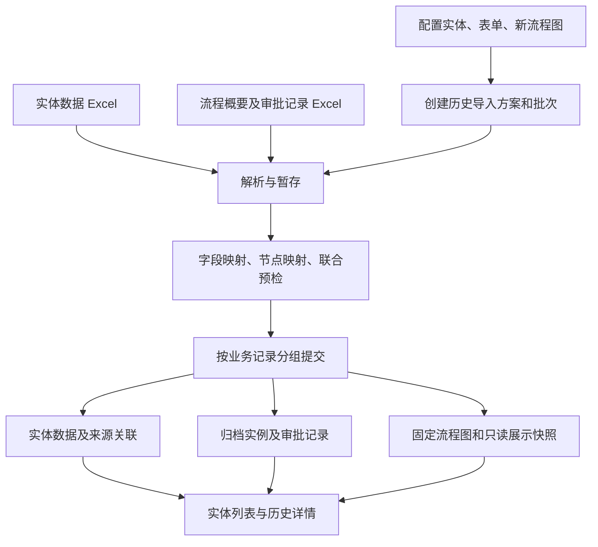

# 已完成流程历史数据导入实现方案

日期：2026-10-16。状态：待实施设计。

本文根据已确认的迁移范围编写。文中新增的数据表、接口、页面和服务均为拟议设计，不代表现有功能已经实现。本次交付只新增本方案文档，不修改运行代码或数据库迁移。

## 1. 目标与范围

在本系统重新配置实体、表单和流程图，通过文件导入旧系统的实体数据、流程概要和审批记录。导入完成后，用户能够从实体列表打开业务数据，查看指定版本的新流程图，并点击节点查看对应的旧审批记录。

已确认的要求：

- 仅迁入已结束流程，不处理在途实例和执行状态恢复。
- 旧系统可以没有流程图，也可以采用任意技术实现。
- 流程图在本系统重新设计；旧记录通过节点映射关联到新图。
- 实体数据和审批记录均通过文件导入，支持分开上传。
- 保存原审批人、原操作、原意见和原时间，保留重复办理和多轮流程。
- 导入结果可校验、可追溯、可重试；重复上传不能重复创建记录。

首期实现两个导入入口：`实体数据导入`、`流程历史导入`。两者属于同一个历史导入批次，最终联合校验、统一执行。

首期不包含：旧系统直连采集、流程引擎转换、自动生成流程图、在途接管、模拟执行审批、统一所有原生流程工作台。附件本体批量搬运作为扩展阶段；首期仅接受经过授权校验的本系统存储文件引用，外部链接单独标记，不能计为已迁入附件。

默认使用 `.xlsx`。实体数据沿用可配置列映射，流程历史使用标准模板。普通新增和普通 Excel 导入的既有行为保持不变。

## 2. 当前代码基础与需要补齐的能力

| 当前实现 | 可复用部分 | 需要新增或调整的部分 |
| --- | --- | --- |
| `EntityExcelRuntimeController`、`EntityExcelCodecService` | 模板、字段转换、文件解析、预检和行错误展示 | 历史迁入上下文、来源标识、两类文件联合预检 |
| `EntityExcelJobService` | 分批事务、任务结果、失败报告的实现经验 | 现有任务是有界同步任务，不能直接视为持久化历史迁移 Worker |
| `EntityDataActionService.createExcelRow` | 实体写入权限和约束处理 | 普通导入仍走表单事件链；不能直接当作无副作用的历史导入 |
| `EntityMutationPort` | 受控实体写入及约束管道 | 增加仅服务端可构造的历史导入入口与行为策略 |
| 流程发布历史 | 已发布 BPMN、流程版本和节点绑定 | 归档展示快照及归档引用保护 |
| `ProcessProgressRuntimeService`、`ProcessInstanceAccessService` | 原生流程详情和鉴权语义参考 | 当前依赖 Flowable，新增独立归档查询和归档授权 |
| `VueBpmnViewer` | 图示、节点点击和多处理人展示 | 归档模式、节点全部记录、无迁入记录状态 |
| `useProcessDetail`、`EntityApprovalHistory` | 表单、流程图、时间线的组合展示 | 按来源读取详情，保留归档标识和记录列表 |

需要明确两项现状：

1. 普通 Excel 导入当前仅支持新增，不自动发起流程，但 `createExcelRow` 仍执行标准表单提交与事件链。历史导入必须明确禁止业务动作，不能只设置 `startProcess=false`。
2. 当前表单使用 `entity_form_published` 保存唯一线上配置。`contentHash` 是内容指纹，不能当作可回查的历史版本。归档需要另存只读展示快照，不恢复已退役的表单版本体系。

代码依据见第 14 节。

## 3. 总体架构与模块职责



| 模块 | 拟议职责 |
| --- | --- |
| `workflow-migration` | 历史导入方案、文件暂存、预检、批次执行、错误报告及对账 |
| `workflow-entity` | 实体历史导入、字段校验、来源与实体关联、归档记录写保护、只读表单快照生成 |
| `workflow-process` | 归档实例、审批记录、节点映射验证、流程图快照、归档查询与对象授权 |
| `workflow-port` | 以上模块之间的专用 Port 和无框架 DTO |
| `workflow-storage` | 原文件、错误报告和被引用附件的存储及访问控制 |
| `workflow-frontend/workflow-web`、`workflow-frontend/packages/workflow-core` | 导入向导、归档详情和公共查询状态 |

跨模块只调用 Port，不直接操作其他模块 Mapper。归档审批记录独立存储，不写 `ACT_*` 引擎表，不创建可执行任务，不往现有 `entity_process_link` 填入归档 ID。

对外只提供本系统登录用户使用的管理接口，不恢复已退役的公共流程集成 API。新流程图作为展示模板，可同时供未来原生流程使用，但本次迁入不会启动它。

## 4. 用户操作与提交时机

### 4.1 配置方案

每个方案修订固定以下内容：

- 来源命名空间：来源系统编码，必要时包含来源租户，确保旧 ID 不跨来源碰撞。
- 来源业务类型、来源流程类型及来源版本分组；没有旧版本时使用明确的 `UNSPECIFIED`。
- 目标实体、已发布实体 Excel 方案和写入表单。
- 用于展示的已发布流程版本及表单快照。
- 字段、业务状态、审批操作、节点和可选人员身份映射。
- 文件日期格式、来源时区、空值规则和已知信息缺失的处理方式。

首期一个批次对应一个目标实体、一个来源流程类型和一个目标流程版本。不同流程或旧版本具有不同映射时分别创建批次；同一实体记录的多轮流程可以出现在同一批次。

### 4.2 两个文件入口

1. 创建批次并选择方案修订。
2. 上传实体数据文件，展示解析结果、字段错误和来源标识。
3. 上传流程历史文件，展示流程概要、审批记录和未匹配节点。
4. 调整映射，执行联合预检，确认数量和示例详情。
5. 执行导入，查看每笔业务记录的结果和错误文件。
6. 从实体列表的“流程历史”打开归档详情。

**实现选择：分开上传，联合落库。** 上传阶段只写暂存表，“已解析/已校验”不等于“实体已新增”。联合预检完成后，才按一笔业务记录及其本次全部历史分组提交。这样不会出现普通用户已经看到实体、审批记录却尚未导入的中间状态。

需要复用普通 Excel 的解析与校验组件，但不能先调用普通导入接口提交实体，再尝试补审批记录。界面明确区分“上传成功”“校验通过”和“导入完成”。

## 5. 文件模板与关联规则

### 5.1 实体数据文件

一个业务记录一行。业务字段由目标实体导入方案生成，附加以下迁移元数据列：

| 列 | 必填 | 规则 |
| --- | --- | --- |
| `sourceRecordId` 原业务记录 ID | 是 | 按文本读取，保留前导零；与来源命名空间、来源业务类型组成稳定身份 |
| `expectedInstanceCount` 本次流程数 | 是 | 本次文件中该记录预期包含的流程概要数，必须大于零，用于检查分组完整性 |
| 业务编号 | 由实体配置决定 | 可检索显示；不能默认代替原业务记录 ID |
| 其他业务字段 | 按目标字段要求 | 类型、精度、字典、必填和关联值明确映射 |

迁移元数据从行数据中分离，不自动新增为动态实体字段。目标主键由系统生成，系统审计字段记录本次真实导入身份和时间，原创建人、创建时间另存来源快照。

首期支持已有 Excel 编解码能力覆盖的字段；关联字段必须解析到可读、合法的目标记录。首期不假定现有 Excel 已支持任意嵌套对象；尚未迁入的子实体或关系依赖在预检中阻止执行，复杂主子表联合迁入放在扩展阶段，不静默丢弃明细。未支持的字段类型同样阻止执行。

给已有同来源实体补导新流程时，也提供实体行及本次 `expectedInstanceCount`；实体字段仅用于一致性校验，不重复新增或改写。每个正式执行组都必须有完整实体行和数量声明。

### 5.2 流程历史文件：`流程概要` Sheet

| 列 | 必填 | 规则 |
| --- | --- | --- |
| `sourceInstanceId` 原流程实例 ID | 是 | 作为一次流程的身份，不用业务记录 ID 代替 |
| `sourceRecordId` 原业务记录 ID | 是 | 关联本批次实体行；存在同来源实体映射时校验后复用目标记录 |
| `sourceProcessName` 原流程名称 | 是 | 保留原名称，新图名称另存 |
| `sourceRound` 来源轮次 | 否 | 源系统提供时保存；缺失时不宣称推导序号是原轮次 |
| `initiatorId`、`initiatorName` | 至少名称 | 原人员身份快照；本系统账号关联单独配置 |
| `startedAt`、`endedAt` | 可缺失但须声明 | 保留原值；缺失时标记不完整，禁止填导入时间代替 |
| `sourceResult` 原结束结果 | 是 | 只能映射为已结束结果；正在审批、挂起等不能进入本方案 |
| `expectedEventCount` 预期审批记录数 | 是 | 对应审批 Sheet 的行数；零条必须明确确认缺少记录或原本无人工审批 |
| `endComment` 结束说明 | 否 | 保留原说明，不用于猜测审批结果 |

统一生命周期为 `COMPLETED`，结束结果独立为 `APPROVED / REJECTED / WITHDRAWN / TERMINATED / COMPLETED_UNKNOWN`。`COMPLETED_UNKNOWN` 只允许来源明确已结束但结果未知的情况。

时间解析使用方案的显式时区，存储统一时间和原始文本；夏令时歧义、无法解析或结束早于开始均报错。源数据缺失需在预检中逐项列明，由导入者接受后才能继续。

### 5.3 流程历史文件：`审批记录` Sheet

| 列 | 必填 | 规则 |
| --- | --- | --- |
| `sourceEventId` 原审批/操作记录 ID | 是 | 每次操作独立 ID；不能只用节点 ID 或任务 ID |
| `sourceInstanceId` 原流程实例 ID | 是 | 必须存在对应流程概要 |
| `sourceNodeCode`、`sourceNodeName` | 至少一项 | 优先按编码匹配；仅名称时必须确认唯一性 |
| `sourceTaskId`、`sourceOccurrenceId` | 否 | 标识旧任务和节点本次办理，可用于会签及重复审批分组 |
| `actorId`、`actorName` | 至少名称 | 保留原值；账号映射不覆盖原姓名 |
| `sourceAction` 原操作 | 是 | 通过方案映射审批通过、拒绝、退回、转办、提交等操作 |
| `comment` 审批意见 | 否 | 按文本保存和安全渲染 |
| `handledAt`、`sourceSequence` | 至少一项 | 缺少时间时使用原序号排序；不伪造时间 |

旧系统无操作 ID 时，整理文件时提供可重复使用的人工稳定编号。系统可以辅助生成并下载补全文件，但后续必须复用该编号；文件行号不能作为跨文件去重键。

一次转办、一次退回、一次通过是不同事件。统一操作码保留 `OTHER`，并同时保存原操作文本；“驳回”究竟是退回上一步还是最终拒绝，必须由方案明确，不能仅凭文字猜测。

同一实例的完整时间线优先使用可用的来源序号，其次使用处理时间和稳定 ID。序号与时间矛盾时报告数据质量问题，不擅自重排成符合新图的顺序。

### 5.4 关联示例

```text
来源 OA_A / 业务类型 expense / 原业务 B001 -> 实体 expense / 新记录 E001
来源 OA_A / 流程类型 reimbursement / 原实例 P001 -> 归档实例 H001 -> E001
P001 / 审批记录 A001 / 旧节点 dept_review -> 新流程 V1 / 节点 deptApproval
P001 / 审批记录 A002 / 旧节点 dept_review -> 新流程 V1 / 节点 deptApproval
```

两条审批都保留，点击 `deptApproval` 展示两条记录。另一个原实例 P002 可以关联同一个 E001，作为独立历史流程，不覆盖 H001。

## 6. 节点映射、流程图和表单快照

### 6.1 节点映射

映射键为来源流程类型、来源版本分组、旧节点编码；无编码时使用显式确认的旧节点名称。映射值为目标流程版本快照中的节点 ID。

- 一个旧节点可映射到一个新节点；多个旧节点可映射到同一新节点，但必须在预览中提示合并，并保留原节点名称。
- 一个旧节点需要拆分到多个新节点时，增加基于明确来源字段的判定规则，或在文件中提供区分编码；首期不自动复制审批事实。
- 会签与重复办理只根据旧任务/办理标识分组。仅审批时间接近不能证明属于同一次会签。
- 新节点无记录时显示“无迁入记录”，不显示“未开始”或“审批通过”。
- 映射不到的记录默认阻止正式执行。确实无对应节点时，允许明确设置 `TIMELINE_ONLY` 并填写原因；记录仍出现在完整时间线和对账中，预览显示提示。
- 目标节点已删除或不在选定版本中时预检失败。改节点名称不影响已保存的 ID 关联。

### 6.2 归档图示语义

新增 `HISTORICAL_IMPORT` 展示模式。图上使用“有迁入记录 / 无迁入记录”标识；节点的具体结果由事件列表展示。转办、退回等记录不能简单转换为 `completedNodes`。

点击节点打开完整记录列表，至少包含原节点、原审批人、操作、意见、时间、来源轮次/任务。默认按确定的历史顺序排列；多条记录不能使用 `.find()` 或单值 `nodeAssigneeMap` 覆盖。

没有源路径证据时，`executedSequenceFlows` 为空，不根据新图条件或旧业务终值计算历史走向。新图上的开始、结束和网关也不能补造审批事件。页面显示“按新流程图映射的历史记录”。

### 6.3 固定展示内容

预检时生成归档展示快照，包含：

- 所选已发布流程的 BPMN XML、流程标识、发布历史 ID、版本号和内容 hash。
- 节点列表、节点表单绑定和映射方案修订。
- 当时选定的表单只读结构、字段标签/类型、字典显示值、子表单展示依赖及内容 hash。
- 渲染器 schema 版本，用于后续兼容升级。

快照由实体和流程模块各自生成，归档服务保存完整引用及不可变内容。仅存 `formId` 或当前配置 hash 无法固定表单，不能作为实现替代。

只读表单只渲染归档值，不执行 `FORM_INIT / AFTER_LOAD / BEFORE_SUBMIT`、远程数据源或自定义业务脚本。动态组件无法离线只读展示时，预检提示并回退为标签和值的只读明细；不能悄悄加载当前业务数据。

实体文件通常只提供最终业务数据，归档中标记 `dataScope=ENTITY_FINAL`。同一实体多轮流程引用该数据时，要提示“本次导入的最终业务数据”，不能声称是每轮或每个节点当时的快照。逐轮/逐节点快照作为后续可选输入扩展。

目标流程和表单再次发布后，既有归档仍使用原快照。映射和展示纠错必须产生新修订、保留原修订及操作审计，首期不提供对已完成归档的静默覆盖。

## 7. 持久化模型

以下为拟议逻辑表名及主要字段；实施时补齐长度、索引、注释和审计列，不能直接视为已执行 DDL。

| 表及所属模块 | 主要字段 | 约束与用途 |
| --- | --- | --- |
| `history_import_plan` / migration | `id, plan_code, revision, source_namespace, source_entity_type, source_process_type, source_version_group, target_entity_code, target_process_history_id, mapping_document, status` | 唯一 `(plan_code, revision)`；被执行批次引用的修订不可修改，修改方案创建新修订 |
| `history_import_batch` / migration | `id, plan_id, owner_id, revision, state, input_files_json, input_hash, validation_hash, counters_json, lease_owner, lease_until, retry_count` | 同一批次配置和文件内容有修订号；执行认领与超时恢复持久化 |
| `history_import_item` / migration | `id, batch_id, kind, group_key, source_key, file_id, sheet_name, row_no, raw_json, normalized_json, payload_hash, state, errors_json, target_id` | `kind=ENTITY/INSTANCE/EVENT`；保存原始坐标、标准化结果和每个提交组的进度 |
| `entity_import_source_link` / entity | `id, source_namespace, source_entity_type, source_record_id, entity_code, entity_record_id, payload_hash, raw_snapshot_json, state, first_batch_id` | 唯一来源业务身份；目标实体记录也设唯一约束；保存来源与目标关系，作为归档写保护依据 |
| `process_archive_snapshot` / process | `id, schema_version, process_history_id, process_key, process_version, bpmn_xml, node_index_json, readonly_forms_json, content_hash` | 保存完整展示材料；内容相同可复用，引用后不可修改 |
| `process_archive_instance` / process | `id, source_namespace, source_process_type, source_instance_id, source_record_id, entity_code, entity_record_id, source_round, initiator_snapshot_json, started_at, ended_at, end_result, raw_result, snapshot_id, mapping_snapshot_json, payload_hash, data_snapshot_json, data_scope, quality_json, visibility, first_batch_id` | 唯一来源流程身份；每轮独立关联实体、图快照、映射和来源事实 |
| `process_archive_event` / process | `id, archive_instance_id, source_event_id, source_task_id, source_occurrence_id, source_node_code, source_node_name, target_node_id, mapping_mode, actor_snapshot_json, mapped_user_id, action, raw_action, comment, handled_at, source_sequence, raw_json, payload_hash` | 唯一 `(archive_instance_id, source_event_id)`；一个节点可以对应多条事件 |
| `process_archive_file_ref` / process | `id, archive_instance_id, event_id, storage_file_id, original_name, source_file_key, content_hash, reference_kind` | 文件关系与归档关联；下载按所属实例、记录和文件权限检查，不暴露裸存储地址 |

补充约束：

- 来源身份的比较规则必须明确：ID 按文本保留，不大小写折叠，不因数据库默认排序规则将 `A01` 与 `a01` 合并。按来源约定去除无意义空格，原值仍保存。
- 长来源身份可使用规范化身份的 SHA-256 建唯一索引，同时保存完整原身份，并在命中后比较原身份，禁止截断 ID。
- 文件行号只用于错误定位。来源键、文件 hash、内容 hash 和请求幂等键职责不同，不能混用。
- 暂存数据和原文件按批次访问权限保存；标准化时不覆盖原始数据。源 JSON 不直接拼接到页面或 SQL。
- 归档事件、文件关系指向存在的归档实例；`target_node_id` 必须由快照节点索引验证。`TIMELINE_ONLY` 允许节点为空，原因必须保留。
- 归档与原生流程标识分离。归档记录使用 `archiveId`，不能将其写入原生 `processInstanceId` 或 `currentTaskId` 等字段。
- 默认只新增来源映射，不通过相似业务编号自动绑定既有普通业务记录。已有同来源映射只有目标实体一致、内容一致且无原生在途流程时才可复用。
- 归档实例增加 `(entity_code, entity_record_id, visibility, ended_at, id)` 查询索引；事件增加 `(archive_instance_id, target_node_id, source_sequence, handled_at, id)` 索引。列表先授权再分页。

## 8. 导入执行、事务与幂等

### 8.1 批次状态

```text
DRAFT -> UPLOADED -> VALIDATING -> READY -> RUNNING
                           |                   |-> SUCCEEDED
                           -> INVALID          |-> PARTIAL_SUCCESS
                                               -> FAILED
```

`DRAFT / UPLOADED / INVALID / READY` 可调整文件或映射，任何调整都会使已有预检结果失效。`RUNNING` 禁止修改输入；执行前校验批次 revision、文件 hash、方案修订、目标配置指纹和预检 hash。

`PARTIAL_SUCCESS / FAILED` 支持重试未完成组。相同输入的重试沿用已冻结的输入与映射；修正文件后生成关联的新批次，依靠来源键复用已经成功的数据，原批次报告保留。

`SUCCEEDED` 表示本批次申报的所有业务组已处理成功或一致复用，不表示旧系统所有历史都已搬完。来源导出总数与跨批次对账需要另行核对。

### 8.2 联合预检

预检至少检查：

1. 文件类型、格式版本、大小、行数、Sheet、必要表头及重复来源键。
2. 实体字段类型、长度、精度、枚举、唯一性、字段写权限、关联记录可访问性。
3. 来源业务记录、流程概要、审批记录之间的引用和各组预期数量。
4. 每个实例明确已结束；业务状态与审批结果分别映射，不能只填一个“已完成”。
5. 目标流程版本可读且快照完整；节点映射全部有效或明确归为 `TIMELINE_ONLY`。
6. 原人员信息可显示，拟关联本系统账号存在且映射有权限；同名不能自动认定为同一人。
7. 时间与排序信息可解释；缺失、未知操作、零审批记录等质量问题列入确认清单。
8. 相同来源键的已有记录内容是否一致，是否存在并发导入或原生流程冲突。
9. 所有必需的只读组件和字典显示值是否可固化；不支持组件提供明确回退。

输出包括实体数、实例数、事件数、明确未映射数、数据质量提示、重复一致数、冲突数及示例详情。示例图和正式查看使用同一套归档渲染器。

预检只能确认输入的内部一致性。`expectedEventCount` 与审批 Sheet 一致不能证明源系统没有漏导；迁移验收还要与来源导出报告及样本核对。

### 8.3 提交单位

一次数据库事务处理一个 `sourceRecordId` 对应的业务组：实体记录、来源映射、本次所有流程概要、所有审批记录、快照引用和导入结果一起提交。这样允许不同业务组部分成功，但同一笔业务不能只导入一半历史。

推荐步骤：

1. Worker 通过带版本号的更新认领批次，获取执行租约；事务内再次验证执行权。
2. 按持久化的执行申请人身份重新检查授权，锁定/占用来源业务键；所有路径采用一致锁顺序。
3. 复核配置指纹、实体约束和来源冲突，不能把预检结果当成永久授权。
4. 通过实体历史导入 Port 创建实体，或校验并复用同来源的归档实体。
5. 通过归档写入 Port 创建实例和事件，保存业务终值及只读展示快照引用。
6. 写入来源映射、结果计数和该组 `COMMITTED` 状态，提交事务。

协调服务持有事务；各 Port 写入在同一个数据库事务中执行，禁止用 `REQUIRES_NEW` 单独提交实体或归档历史。唯一约束冲突回滚该组后重新查询并比较，不在已失败事务内继续提交。

异步 Worker 不依赖请求线程的 `UserContext`，也不使用全权限系统身份替代申请人。后台任务通过受控执行上下文恢复申请人身份并重新鉴权，角色或权限被撤销后停止后续组；任务审计同时记录申请人、批次和执行器。

无数据库事务可覆盖外部对象存储。原文件及附件先暂存，只有提交的数据库关系使其成为正式引用；未引用文件按保留期清理。首期执行阶段不进行远程业务调用。

### 8.4 重复导入与并发

- 请求级：相同 `requestId` 和请求摘要返回同一任务；相同键但内容不同返回冲突。
- 业务级：不同批次仍使用稳定来源身份去重，不能将 `batchId` 纳入来源唯一键。
- 内容级：同一来源键和相同标准化内容为一致复用；内容、目标实体、图版本或映射不同，报告冲突，不能覆盖。
- 事件级：唯一键包括所属来源实例和原事件 ID，允许不同实例存在相同旧事件 ID。
- 同一实体补导新的已结束实例时，要求实体数据一致，不更新原实例和原事件。
- Worker 崩溃后，未提交事务回滚；已提交组通过结果表恢复。租约失效后旧 Worker 必须失去继续提交的资格，避免新旧 Worker 同时推进。
- 批次计数从已提交组和错误状态计算，不能用内存计数作为唯一依据。

内容 hash 的规范化必须版本化：使用确定的字段顺序、明确的空值规则、统一时间与十进制表示，同时保留原始文本。不要将上传时间或文件行号加入业务内容 hash。

### 8.5 实体写入行为

拟新增 `EntityHistoricalImportPort`，实现位于 `workflow-entity`：

- 仅由已鉴权的批次执行服务构造历史导入上下文，不接受客户端任意传入 `skipPermission` 或 `skipHooks`。
- 保留实体类型、长度、唯一性、关联完整性、字段权限、标准系统审计与必要业务版本记录。
- 通过受控变更管道写入，禁止迁移模块直接执行动态表 INSERT。
- 禁止触发表单业务事件、接口写入、通知、流程动作及流程启动；新增历史导入来源类型，并对变更管道内相关扩展逐项验证。
- 允许平台明确实现的纯值转换和校验，不用执行任意表单脚本来取得历史值。
- 系统审计记录真实导入人和导入时间；源系统人员、时间保存为来源事实，不冒充当前操作。

**现有 `createExcelRow` 不能直接承担此职责。** 复用边界是解析、字段规则和受控持久化组件；历史写入策略必须独立明确。若某项既有业务约束依赖外部副作用，应在预检中报出不可迁入原因，不能为了完成导入跳过约束。

## 9. 查询、权限与只读限制

### 9.1 查询来源

首期从实体列表进入历史详情，查询该实体关联的归档轮次。使用明确的记录引用：

```json
{
  "sourceType": "HISTORICAL_IMPORT",
  "archiveId": "H001",
  "entityCode": "expense",
  "entityRecordId": "E001"
}
```

原生详情继续使用 `FLOWABLE + processInstanceId`。前端按来源选择接口，共用流程图和时间线展示组件。不能在原生接口鉴权失败时自动退回归档查询，也不能仅凭 ID 前缀决定权限。

归档详情 DTO 建议包含：`archiveId, source, entityRef, lifecycle, endResult, snapshot, entityData, dataScope, nodeRecordCounts, nodeEvents, timeline, rounds, qualityFlags, capabilities`。

`nodeEvents` 按节点返回全部记录；大记录量场景使用独立分页查询。`capabilities` 仅表示查看、下载等展示能力，所有变更能力为 false，服务端仍独立校验。

### 9.2 授权

- 配置和执行分别使用 `history-import:configure / history-import:execute`；报告读取使用 `history-import:read`。
- 实体写入同时要求该实体的导入、创建权限和有效字段权限。
- 普通归档查看要求 `process:archive:read` 以及关联实体当前的数据读取范围和字段范围。身份映射本身不自动扩大可见范围。
- 有“仅创建者可读”等权限配置的实体，需要明确配置有效的数据归属或历史查看范围。原审批人、原申请人的显示快照与用于授权的本系统身份必须分开。
- 导入者可通过批次管理权限预览自己被授权管理的批次，不能因此查询整个实体或其他来源数据。
- 人员映射需稳定标识和明确确认；离职或无法映射人员仍保留姓名，不创建可登录账号，也不自动授权给同名账号。
- 列表、归档轮次、节点事件、详情和附件下载共用对象授权规则，先过滤范围再分页计数。
- 当前字段权限变化后，归档快照也执行字段过滤；已无法识别的旧字段默认不向普通用户开放，不能因为快照存在就绕过权限。

### 9.3 记录只读与来源状态

归档来源实体默认只读。实体能力计算和后端写入命令都要检查 `entity_import_source_link`，阻止编辑、删除、发起、重新发起及会改写该记录的批量操作，不能只隐藏按钮。

这项检查位于实体模块，避免创建 `workflow-entity` 对 `workflow-process` 内部实现的反向依赖。未来如需以历史数据发起新业务，采用显式复制生成新记录，并保留来源引用，不复用归档实例为原生流程。

实体列表增加来源、历史流程数量和查看入口。归档来源的“已结束”由归档摘要返回，不伪造原生 `processInstanceId`，不因原生流程链接为空而显示为“未发起”。业务实体状态独立保留导入映射的值。

### 9.4 纠错与撤销边界

首期执行后不自动删除已成功实体。失败组重试，成功组保留；错误批次只能由有权限人员先将归档设为隐藏并记录原因，隐藏应同时影响列表和详情，数据留存供追查。

已发布归档的内容或节点映射修正需后续专门的修订操作。首期报告冲突并停止覆盖，不能把重新导入当成更新接口。物理清理仅作为另行设计的管理能力，不复用现有配置包回滚接口。

## 10. 拟议接口与应用服务

以下是登录态内部接口草案。新建/修改请求使用明确 DTO，更新带 `expectedRevision`，执行带 `requestId`；错误沿用平台标准响应。

| 方法与路径 | 用途 |
| --- | --- |
| `POST /api/history-import/plans` | 保存新的方案或方案修订，校验目标引用和权限 |
| `GET /api/history-import/plans` | 分页查询可使用的方案 |
| `POST /api/history-import/batches` | 按方案修订创建批次 |
| `GET /api/history-import/batches` | 分页查询有权查看的批次 |
| `GET /api/history-import/batches/{id}` | 查询批次状态、计数和输入摘要 |
| `GET /api/history-import/batches/{id}/templates/{kind}` | 下载该批次绑定配置的实体/历史模板 |
| `POST /api/history-import/batches/{id}/files/{kind}` | 上传实体或历史文件，仅解析暂存 |
| `PUT /api/history-import/batches/{id}/mappings` | 修改未执行批次的映射，增加修订并使预检失效 |
| `POST /api/history-import/batches/{id}/validate` | 联合预检，返回预检任务及最终摘要 |
| `GET /api/history-import/batches/{id}/preview` | 读取已授权的暂存样例及图示 |
| `POST /api/history-import/batches/{id}/execute` | 校验 revision 与 validationHash 后认领执行，返回 202 和任务 ID |
| `POST /api/history-import/batches/{id}/retry` | 相同输入重试未完成组，不能修改已成功组 |
| `GET /api/history-import/batches/{id}/errors` | 分页读取行级错误 |
| `GET /api/history-import/batches/{id}/report` | 下载计数、失败数据与对账报告 |
| `GET /api/process-archives` | 按实体、来源、结束时间等条件查询可读归档 |
| `GET /api/process-archives/{id}` | 读取归档详情、快照和节点计数 |
| `GET /api/process-archives/{id}/events` | 分页读取完整或按节点筛选的审批记录 |
| `GET /api/process-archives/{id}/rounds` | 查询同一实体的可读归档轮次 |
| `GET /api/process-archives/{id}/files/{fileRefId}` | 授权后获取文件，校验其确属该归档 |

事件分页须支持仅完整时间线可见的 `TIMELINE_ONLY` 记录；不能因无 `target_node_id` 被过滤掉。批次上传模式、目标配置和对象 ID 都由服务端校验，不接受修改 Excel 隐藏字段来替换目标流程。

建议的内部 Port：

| Port（均为新增） | 实现与职责 |
| --- | --- |
| `EntityHistoricalImportPort` | entity：预检、历史实体创建/一致复用、保存来源关系；写入要求已有事务 |
| `EntityArchiveViewPort` | entity：生成只读快照、检查当前读取及字段权限、获取归档数据范围 |
| `ProcessArchiveImportPort` | process：验证图版本与节点、创建归档实例和事件、提供幂等比较结果；写入要求已有事务 |
| `ProcessArchiveQueryPort` | process：归档详情、轮次、节点记录、对象授权 |

迁移服务使用结构化结果，如 `CREATED / REUSED / CONFLICT`，并返回真实目标 ID。暂存、预检、执行的异常应区分可修正数据错误与系统故障，不把鉴权失败或数据库异常当成“没有历史记录”。

## 11. 页面改造与实施顺序

### 11.1 页面

新增“历史流程导入”管理页面，包含：

- 方案列表：来源、目标实体、目标流程版本、方案修订和最近使用情况。
- 批次向导：选方案、实体上传、历史上传、映射、预检、执行结果。
- 映射面板：旧节点去重列表、新图节点选择、合并提示、仅时间线记录和原因。
- 预检页：分组计数、阻断错误、质量提示和可点击的归档图预览。
- 结果页：创建/一致复用/失败数量，按实体记录查看其全部流程和审批记录。

实体列表增加“历史迁入”来源标记及“流程历史”入口。归档详情显示来源、原业务编号、原流程实例、数据范围、结束结果、新图展示版本、业务表单、节点记录及完整时间线。

复用 `VueBpmnViewer` 的加载、缩放和节点定位能力，为归档模式新增状态及事件列表。修改 `useProcessDetail` 时保留原生加载、请求防串页逻辑；归档 ID 不进入原生历史兜底接口。PC 和共用状态包同步调整；移动端至少能够只读查看业务和完整审批时间线，不显示办理按钮，图示交互按现有移动端能力适配。

### 11.2 分阶段任务

| 阶段 | 工作内容 | 完成条件 |
| --- | --- | --- |
| P0：样本与契约 | 选择一个实际旧流程，整理实体、概要、审批三类样本；确定映射、结果码、身份和时间规则 | 普通审批、退回重提、多轮、人员缺失等样本能用模板表达 |
| P1：存储与实体导入 | 新增表、Port、暂存和实体历史写入策略；来源关联、写保护、稳定键与事务 | 一笔业务及其历史能原子创建，重复执行一致复用，业务事件不触发 |
| P2：归档详情 | BPMN 与只读表单快照、归档授权、实体列表入口、节点全部记录、完整时间线 | 能从实体记录打开新图，核对全部原审批信息，后续发布不改变归档 |
| P3：导入闭环 | 模板下载、两次上传、映射编辑、联合预检、Worker、报告、重试及并发恢复 | 用户无需脚本即可完成完整迁入；失败和中断结果可解释、可恢复 |
| P4：按实际需求扩展 | 附件包搬运、原始逐轮/逐节点业务快照、复杂关系数据、映射修订、原生与外部统一工作台 | 每项以真实来源样本和相应验收用例单独交付 |

P0—P3 构成首期完整交付，不能只完成后端批量写入就宣称功能完成。开发过程中可以先以标准样本验证服务，再完成管理页面。

## 12. 测试与验收

以下为实施后的计划检查，本次文档编写未执行这些功能测试。

| 场景 | 预期结果 |
| --- | --- |
| 基本串行审批 | 实体数据、归档概要、事件数量一致；点击新图节点看到对应原记录 |
| 同节点退回后再次审批 | 所有操作独立保留，按来源顺序查看，不覆盖为最后一条 |
| 多人审批 | 各人姓名、结果、时间、意见均可见；有来源办理标识才分组 |
| 一个实体两轮流程 | 实体只创建一次，归档实例两条，轮次切换不串数据 |
| 旧节点合并到一个新节点 | 图上同一节点列出全部记录，并保留旧节点名称 |
| 新节点没有历史记录 | 显示“无迁入记录”；不会自动标为已通过 |
| 无法匹配的旧节点 | 默认预检失败；明确设为仅时间线后仍计入数量并完整展示 |
| 已结束但结果未知 | 生命周期已结束、结果未知，不能显示审批通过 |
| 原申请人或审批人已离职 | 原姓名仍可显示；无本系统账号也可归档，不创建登录账号 |
| 同名账号、无权身份映射 | 不自动绑定，不因姓名相同授予历史读取权限 |
| 缺少审批时间 | 显示缺失标记，用明确来源序号排列，不填当前时间 |
| 审批记录缺少所属实例 | 预检失败，不产生孤立历史 |
| 申报数量与实际行数不符 | 阻止对应业务组执行并定位错误 |
| 同一文件、不同 requestId 重复上传 | 来源键生效，实体和审批记录不重复 |
| 换文件或批次重复迁入 | 内容一致则复用；不同内容或不同图版本则冲突 |
| 同一 requestId 不同内容 | 返回幂等冲突，不复用旧结果假装成功 |
| 两个 Worker 同时执行同一组 | 唯一约束与执行权校验保证只提交一次 |
| 实体写入后归档写入失败 | 同一事务回滚，无孤立实体、映射或半条历史 |
| 提交后响应丢失、进程重启 | 查询已提交组并返回真实结果，不重新创建 |
| 部分业务组失败 | 成功组保留，报告准确；重试只处理失败/未执行组 |
| 表单配置包含 HTTP、通知等事件 | 历史写入和归档查看均不触发事件，不产生业务 Outbox |
| 流程图和表单再次发布 | 旧归档仍显示原冻结内容和节点映射 |
| 子表单或组件不能离线展示 | 预检给出明确回退，详情不调用当前数据源 |
| 无源流转路径 | 不高亮为实际执行连线，不生成网关和开始/结束审批记录 |
| 绕过页面直接调用实体修改/启动 API | 服务端拒绝对归档来源记录执行变更和启动 |
| 查询他人批次、越权归档、附件串实例 | 返回授权错误；列表总数和分页也遵守同一数据范围 |
| 归档字段权限收紧 | 快照中的受限字段也不可见 |
| 原生流程回归 | 正常发起、审批、历史图示、表单和普通 Excel 导入行为保持正确 |

测试分层：

1. 单元测试验证稳定身份、内容规范化、映射、时间解析和来源操作转换。
2. 数据库集成测试验证唯一键、分组事务、并发认领、租约恢复和跨批次幂等；不能只依靠 mock 证明事务一致性。
3. 服务集成测试验证实体约束、归档授权、字段裁剪和所有副作用的禁止规则。
4. 前端测试验证来源分流、归档节点列表、轮次切换及无记录状态；实际浏览器验证从上传到查看的完整路径。
5. 使用实际来源样本进行逐笔核对，生成最终对账报告。

对账报告至少包含：来源导出申报数、文件解析数、成功创建数、一致复用数、失败数、仅时间线记录数和信息缺失数。区分“输入事件行数”和“新写入事件数”，不能把复用计成新增；错误报告中的用户文本按文本导出，避免被 Excel 当作公式执行。

容量验证以真实样本和部署约束确定上线限额。首期所有文件字节数、Sheet 数、总行数、单业务组实例/事件数、单元格长度和单次事务时长必须有明确上限；超过上限返回可操作错误，不无限制加载。单个业务组过大不能自动拆成可能留下半条历史的提交，应阻止并专项处理。

## 13. 数据库迁移、部署与运维

### 13.1 Flyway 规范

本文编写时仓库观察到的最高版本为 `V123`；该信息仅记录现状，不预占下一版本。正式实施前重新扫描 SQL 和 Java 迁移的全部版本，选择更高且未占用的版本号。

- 新表、索引和权限菜单通过新增 `Vxxx__*.sql` 或必要 Java 迁移实现。
- 不修改、删除、重命名主分支已有迁移，不同步改写 `V001__business_schema.sql`。
- 不为本功能建立全量基线，不使用 `flyway repair`。
- 按职责可以拆分存储、索引、权限等迁移，具体数量由最终实现决定。
- 最终提交检查与主分支的迁移差异，并明确列出新增、修改或删除文件。

### 13.2 部署顺序

1. 独立迁移任务创建新增结构及权限，保留现有原生流程表不变。
2. 部署后端和前端，历史导入执行开关默认关闭；查询和写保护能力随代码提供。
3. 在测试环境完成一批真实样本，核对无流程实例、任务和业务通知被创建。
4. 开启受限管理员导入权限，执行小批次并核对报告。
5. 完成限额与恢复验证后，逐步扩大批量。

执行开关关闭后应停止认领新任务，允许当前业务组按约定完成或回滚；不影响已归档记录查询。发布回退必须保留归档来源写保护，不能回退到会把已导入实体当成普通待发起记录的旧代码。

### 13.3 观测与留存

记录批次耗时、业务组提交数、失败原因、重复复用数、认领冲突和租约超时。日志使用批次/对象标识，避免输出完整业务表单、审批意见或敏感附件内容。

原文件、暂存数据和错误文件设定保留期，清理前确认批次终态且不再需要重试；来源关联、正式归档、展示快照和审计长期保留策略由部署方配置。正式快照不能因为批次文件到期而删除。

本次文档变更的数据库迁移文件清单：**新增无，修改无，删除无。**

## 14. 代码依据与实施定位

以下链接说明当前实现基础，不表示拟议功能已经存在：

- [现有实体 Excel 接口](../workflow-server/workflow-entity/src/main/java/com/workflow/entity/excel/api/web/EntityExcelRuntimeController.java)
- [Excel 方案校验与不启动流程限制](../workflow-server/workflow-entity/src/main/java/com/workflow/entity/excel/config/ExcelSchemeValidator.java)
- [实体 Excel 任务与事务](../workflow-server/workflow-entity/src/main/java/com/workflow/entity/excel/runtime/EntityExcelJobService.java)
- [普通实体导入及表单事件链](../workflow-server/workflow-entity/src/main/java/com/workflow/entity/data/application/EntityDataActionService.java)
- [实体受控变更 Port](../workflow-server/workflow-port/src/main/java/com/workflow/contracts/entity/mutation/port/EntityMutationPort.java)
- [实体当前发布表单模型](../workflow-server/workflow-entity/src/main/java/com/workflow/entity/form/infrastructure/persistence/record/EntityFormPublished.java)
- [流程发布与稳定表单身份绑定](../workflow-server/workflow-process/src/main/java/com/workflow/process/publish/application/ProcessUiReleaseBindingService.java)
- [原生流程进度组装](../workflow-server/workflow-process/src/main/java/com/workflow/process/instance/application/ProcessProgressRuntimeService.java)
- [原生流程对象授权](../workflow-server/workflow-process/src/main/java/com/workflow/process/instance/application/ProcessInstanceAccessService.java)
- [原生流程轮次查询](../workflow-server/workflow-process/src/main/java/com/workflow/process/instance/application/ProcessRoundService.java)
- [流程图展示组件](../workflow-frontend/workflow-web/src/components/VueBpmnViewer.vue)
- [公共流程详情状态](../workflow-frontend/packages/workflow-core/src/composables/useProcessDetail.js)
- [审批历史展示](../workflow-frontend/workflow-web/src/views/entity/components/approval/EntityApprovalHistory.vue)
- [开放集成边界 ADR](architecture/decisions/0007-retire-open-process-integration.md)

## 15. 首期交付检查清单

- [ ] 完成实际来源样本和两类 Excel 模板。
- [ ] 完成方案修订、字段/节点/操作映射和只读展示快照。
- [ ] 完成实体历史写入入口、来源映射及后端写保护。
- [ ] 完成归档实例、事件、查询、授权及来源分流。
- [ ] 完成联合预检、分组事务、幂等、Worker 恢复和对账报告。
- [ ] 完成上传向导、实体列表入口、流程图节点记录及完整时间线。
- [ ] 通过事务、并发、权限、无副作用与原生功能回归测试。
- [ ] 逐笔核对实际样本，确认导入数据、审批意见和显示节点一致。
- [ ] 列明最终新增迁移文件，检查主分支历史迁移未被改动。
