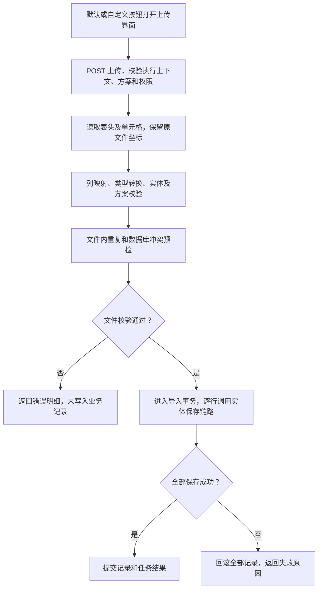

# 实体 Excel 导入导出设置与按钮使用方案

状态：首版已实现并完成自动化回归；真实业务环境端到端联调未执行。更新日期：2026-10-12。使用说明见仓库 `docs/entity-excel-usage.md`。

用户已确定导入语义：批量导入实体记录，校验通过后直接保存。实体维护导入导出方案及默认设置，表单、列表的自定义按钮选择使用方案，系统默认按钮使用实体默认设置。接口请求方式统一使用 GET 或 POST。本文作为后续开发依据。

## 1. 方案结论

在“实体设计”增加“Excel 导入导出”页签，包含“默认设置”和“方案管理”。一个实体可维护多套 Excel 方案，每套方案定义列映射、转换格式、附加校验及执行策略。每个实体分别指定一个默认导入方案和一个默认导出方案，两者可以是同一套方案。实体配置只负责规则和默认选择；按钮配置仍属于具体表单或列表。

默认导入、导出按钮自动使用对应的实体默认方案。表单和列表的自定义按钮可选择“跟随实体默认”或“指定方案”；普通使用者点击按钮即可执行，不需要再次选择方案。方案只决定文件内容及数据处理，按钮决定入口、可用条件和导出数据范围。

自定义按钮沿用现有事件机制：表单使用 `FORM_BUTTON_CLICK`，列表工具栏使用 `TOOLBAR_BUTTON_CLICK`，列表行按钮使用 `ROW_BUTTON_CLICK`。界面提供选择操作和方案的配置区，底层保存到事件使用的接口扩展配置中。系统默认按钮走平台动作入口，与自定义按钮共用同一方案解析和执行服务。

导入时一行对应一条实体记录。用户点击“上传并导入”，服务端先校验整个文件，通过后自动保存。可另行点击“仅校验”检查文件；默认导入不增加人工确认步骤，不把数据回填到当前表单，也不提交当前表单里的未保存内容。

第一版同时支持表单和列表自定义按钮，导入采用“仅新增 + 全部成功或全部回滚”。导出按方案列顺序生成 XLSX，复用现有实体查询、数据权限和游标分页能力。


## 2. 现有能力和需要扩展的部分

| 现有实现 | 本功能如何使用 |
| --- | --- |
| `EntityField` 的类型、必填、唯一、默认值、字典和 `validateRules` | 继承实体规则，Excel 方案仅补充导入格式和更严格的规则 |
| `EntityFieldValidationRuleService` | 执行已有动态字段校验，避免另建一套含义不同的长度、数值和格式规则 |
| `EntityForm.viewConfig.actionBar.customButtons` | 使用已有自定义按钮，继续使用按钮权限、位置和可用条件 |
| `EntityListConfig.toolbarConfig / rowActionConfig` | 工具栏和行自定义按钮通过事件绑定方案，系统默认按钮自动读取默认设置 |
| `UiEventBinding`、接口扩展及 `UiDataSourceProvider` | 在按钮点击事件中绑定 Excel 操作及方案，读接口返回受控执行上下文 |
| 共享事件 `effects` 分发 | 增加 Excel 操作效果的消费能力，打开上传界面或调用导出、模板接口 |
| `EntityDataActionService` 与实体变更事务链路 | 保存时执行已有权限、默认值、事件、业务约束、唯一性和审计处理 |
| `PublishedFormSubmissionService` | 为每个导入记录应用明确选定的写入表单规则，执行权威提交校验 |
| `EntityDataExportService` | 现有输出是 CSV；复用其中的权限语义和受控查询，在新的 Excel 服务中写 XLSX |
| `CurrentFormRuntimeContext` | 沿用当前发布配置和请求受理边界；补充方案依赖摘要 |
| `workflow-excel` 的监听器、转换器、动态表头和分批写入 | 提供底层文件读写；扩展动态单元格元数据和配置驱动的转换能力 |

当前列表已有 `exportSelected`、`exportAll` 默认按钮，没有默认导入；本期增加可启用的 `import` 默认动作，历史列表不会自动增加已启用的导入入口。表单目前没有默认 Excel 按钮，使用已有自定义按钮接入。

当前表单自定义按钮已支持事件链、函数、组件及打开表单/列表等执行方式。本功能使用其中的事件链方式，其 `FORM_BUTTON_CLICK` 接口只允许无副作用的 READ 操作。注册支持 FORM/LIST 上下文的 Excel 操作准备 Provider，供三种自定义按钮事件调用；其他按钮执行方式保持各自含义。上传、导入、导出和模板生成由后续 GET/POST 接口完成，实际业务写入不发生在 READ Provider 中。

`ExcelNotBlank` 等注解校验固定 Java DTO。动态实体使用 `Map<String, Object>`，Map 中的 `name` 键不会自动获得这些注解规则。本功能使用实体元数据和方案规则执行动态校验；固定 DTO 导入仍继续使用注解。

## 3. 配置界面

### 3.1 实体中的方案管理

入口：“实体设计 → Excel 导入导出 → 方案管理”。列表展示方案编码、名称、导入/导出能力、是否默认导入/导出、当前发布状态和引用数量，支持新增、编辑、复制、发布、停用及查看引用。默认标记从实体默认设置计算，不在每套方案上各存一个可冲突的布尔值。

一套方案的编辑内容：

| 区域 | 设置内容 |
| --- | --- |
| 基本信息 | 稳定编码、名称、说明、允许导入/导出 |
| 文件结构 | Sheet 名称、表头行数、数据起始行、未知列策略 |
| 列映射 | 列标题、可接受的旧标题、实体字段、顺序、导入/导出开关、宽度 |
| 值转换 | 日期格式、时区、金额精度及舍入、文本清理、字典使用代码或名称 |
| 导入规则 | 必须存在的表头、附加必填、附加范围、文件内重复检查 |
| 保存策略 | 仅新增；后续可选按唯一业务键更新或新增/更新 |
| 写入表单 | 选择已发布的写入表单，所有文件行统一应用其提交规则 |
| 导出格式 | 文件名规则、Sheet 名称、显示值或原始代码、列宽 |

首版文件结构固定为单行表头（`headRowNumber = 1`）：第一行为标题，第二行起为数据。配置界面与发布校验保持一致，多层表头及独立的数据起始行作为后续扩展。

例如，“员工基础资料”方案可配置：

| Excel 列 | 实体字段 | 转换 | 校验 |
| --- | --- | --- | --- |
| 工号 | `employee_no` | 文本，保留前导零 | 必填、文件内唯一、实体唯一 |
| 姓名 | `name` | 去首尾空白 | 必填、继承字段长度 |
| 入职日期 | `join_date` | `yyyy-MM-dd` | 有效日期 |
| 月薪 | `salary` | 精确十进制，两位小数 | 非负、不允许隐式舍入 |
| 在职状态 | `employment_status` | 绑定代码表，名称转代码 | 代码必须存在且可用 |

模板由同一份已发布方案生成，包含输入列、格式说明和必要的字典说明。说明页不参与数据读取。导出可以包含只读列，但导入映射必须限定在允许写入的字段中。

### 3.2 实体默认设置

```text
Excel 导入导出

默认设置
  默认导入方案  [员工基础资料 ▾]
  默认导出方案  [员工日常清单 ▾]
  [保存草稿] [发布默认设置]

方案管理
  员工基础资料   支持导入/导出   默认导入   已发布
  员工日常清单   支持导出       默认导出   已发布
  财务工资清单   支持导出                  已发布
  [新增方案] [按实体字段生成方案]
```

默认下拉只提供当前实体已发布、已启用且支持相应操作的方案。允许暂不设置某个方向，例如仅开放导出。默认模板使用默认导入方案的列规则，不另设第三个默认模板配置。

首次使用可点击“按实体字段生成方案”，生成普通字段、类型转换和校验规则的草稿，补充写入表单后发布，再设为默认。复杂关系、附件和不可写系统字段不能直接进入默认导入列。初始生成由管理员显式操作完成，读取设置不会自动创建或发布配置。

系统 Excel 按钮存在但没有可用默认方案时禁用并提示“请先配置默认导入/导出方案”；不自动挑选第一套方案。按钮是否启用、摆放位置仍由表单/列表控制；设置默认方案不会自动给所有页面添加按钮。

禁用状态与原因由服务端运行能力解析返回：列表纳入对应按钮的 `enabled/reason`，表单纳入已解析操作能力。普通运行用户不需要读取管理员配置接口，也不由前端自行拼装权限结论。

### 3.3 自定义按钮中的绑定

表单入口：“实体表单 → 表单设置 → 按钮与操作 → 自定义按钮 → 点击事件”。列表入口：“列表设计 → 工具栏按钮/行操作按钮 → 自定义按钮 → 事件链”。

界面提供相同的配置区：

```text
操作        [Excel 导出 ▾]
方案选择    [跟随实体默认 ○] [指定方案 ●]
指定方案    [财务工资清单 ▾]
数据范围    [选中记录 ▾]
```

“跟随实体默认”保存 DEFAULT 引用，不复制当前方案编码；“指定方案”保存 EXPLICIT 引用和稳定编码，后续切换实体默认时不改变这个按钮的选择。

按钮面板维护名称、图标、位置、适用模式、权限和可用条件。事件中的接口扩展维护操作、方案引用模式及导出数据范围。列映射和转换规则统一读取实体方案，不在按钮中复制。

为减少配置步骤，可在自定义按钮的事件编辑器提供 Excel 操作配置区，选择操作和方案后保存对应的接口扩展与事件绑定；不在实体方案编辑器中增加按钮设置，也不自动向表单添加按钮。

快捷配置复用已有事件编辑器，并保留按钮已有的其他事件步骤。现有事件已有主处理时，明确编辑或替换该主处理，不能追加第二个 `REPLACE` 主处理造成执行歧义。

第一版引用当前实体的方案，避免按钮悄悄写入其他实体。子实体导入后续通过已发布关系和受控父记录上下文接入。

导入按钮明确显示“批量新增”，导入结果展示新增数量与失败原因。当前页面若是某条记录的编辑页，导入也不会更新这条记录或保存其未提交字段。

表单按钮沿用 `FOOTER` 或 `ACTION_SLOT`，可在表单布局中添加操作区放置这些按钮。导入前不强制验证当前表单，因为当前表单输入不是这次批量新增的数据源。

### 3.4 默认按钮与各入口的行为

| 入口 | 操作 | 方案来源 | 数据范围 |
| --- | --- | --- | --- |
| 列表默认“导入” | 批量导入 | 默认导入方案 | Excel 每行新增一条记录 |
| 导入窗口的“下载模板” | 下载模板 | 本次导入已解析方案 | 与上传校验使用同一份列定义 |
| 列表默认“导出选中” | 导出 | 默认导出方案 | 当前选中的记录；未选中时禁用 |
| 列表默认“导出全部” | 导出 | 默认导出方案 | 当前列表筛选条件与数据权限内的全部匹配记录，不限当前页 |
| 列表工具栏自定义按钮 | 导入/导出/模板 | 跟随默认或指定 | 导出可选 SELECTED/FILTERED，导入为批量新增 |
| 列表行自定义按钮 | 导出/模板 | 跟随默认或指定 | 导出仅当前行；第一版不在行按钮中配置批量导入 |
| 表单自定义按钮 | 导入/导出/模板 | 跟随默认或指定 | 导出默认当前已保存记录；批量导出需明确绑定已发布列表 |

本期的系统默认入口落在列表导入/导出按钮；表单通过自定义按钮使用。将来增加系统表单导出按钮，也按同一默认解析规则执行。表单新增页没有记录 ID 时禁用当前记录导出。

例如，将“员工基础资料”设为默认导入、“员工日常清单”设为默认导出，再配置列表自定义按钮“财务导出”指定“财务工资清单”。更换默认导出方案后，默认导出按钮和所有跟随默认的自定义按钮一起生效，“财务导出”仍使用其指定方案。

## 4. 配置结构

### 4.1 实体方案示例

以下是建议协议，字段名称在实现时统一纳入结构校验；`schemaVersion` 是 JSON 协议版本。

```json
{
  "schemaVersion": 1,
  "schemeCode": "employee_basic",
  "name": "员工基础资料",
  "file": {
    "sheetName": "员工资料",
    "headRowNumber": 1,
    "unknownColumnPolicy": "REJECT"
  },
  "importConfig": {
    "enabled": true,
    "writePolicy": "CREATE_ONLY",
    "transactionPolicy": "ATOMIC_ALL",
    "writeFormKey": "employee_create",
    "startProcess": false,
    "maxRows": 1000,
    "maxFileSizeMb": 10
  },
  "exportConfig": {
    "enabled": true,
    "fileNamePattern": "员工资料_{yyyyMMddHHmmss}",
    "sheetName": "员工资料"
  },
  "columns": [
    {
      "key": "employee_no",
      "header": "工号",
      "headerAliases": ["员工编号"],
      "fieldCode": "employee_no",
      "importEnabled": true,
      "exportEnabled": true,
      "requiredHeader": true,
      "codec": { "type": "STRING", "trim": true },
      "validation": { "required": true, "uniqueInFile": true }
    },
    {
      "key": "employee_name",
      "header": "姓名",
      "fieldCode": "name",
      "importEnabled": true,
      "exportEnabled": true,
      "requiredHeader": true,
      "codec": { "type": "STRING", "trim": true },
      "validation": { "required": true }
    },
    {
      "key": "join_date",
      "header": "入职日期",
      "fieldCode": "join_date",
      "importEnabled": true,
      "exportEnabled": true,
      "codec": {
        "type": "DATE",
        "format": "yyyy-MM-dd",
        "readPatterns": ["yyyy-MM-dd", "yyyy/MM/dd"]
      }
    },
    {
      "key": "salary",
      "header": "月薪",
      "fieldCode": "salary",
      "importEnabled": true,
      "exportEnabled": true,
      "codec": {
        "type": "AMOUNT",
        "scale": 2,
        "roundingMode": "UNNECESSARY",
        "writeAsText": true
      },
      "validation": { "min": "0" }
    },
    {
      "key": "employment_status",
      "header": "在职状态",
      "fieldCode": "employment_status",
      "importEnabled": true,
      "exportEnabled": true,
      "codec": { "type": "DICT", "importMode": "LABEL_OR_CODE", "exportMode": "LABEL" }
    }
  ]
}
```

字段类型、数据库列名、字典来源及可写性由服务端读取已发布实体定义。文件不能指定数据库表或列，`DICT` 使用字段绑定的代码表，不接受文件或浏览器临时指定另一张代码表。

同一输入字段只能映射一次。标题与别名不能产生歧义。优先按标题匹配，用户调整 Excel 列顺序仍可导入；遇到重复标题、缺少必需列或未知列时给出明确结果。

必需表头和必填值是不同规则。某字段未出现在文件中可使用可信默认值或编码生成器，但最终记录仍须满足实体和写入表单的必填约束。方案不能将实体必填或唯一约束关闭。

### 4.2 默认设置与引用协议

实体默认设置独立于方案内容保存，发布时按方向校验并原子更新：

```json
{
  "schemaVersion": 1,
  "defaultImportSchemeCode": "employee_basic",
  "defaultExportSchemeCode": "employee_daily"
}
```

按钮事件中的方案选择统一使用 `schemeRef`，两种结构互斥：

```json
{
  "operation": "EXPORT",
  "schemeRef": { "mode": "DEFAULT" },
  "dataScope": "FILTERED"
}
```

```json
{
  "operation": "EXPORT",
  "schemeRef": { "mode": "EXPLICIT", "schemeCode": "employee_payroll" },
  "dataScope": "SELECTED"
}
```

DEFAULT 按 operation 选择默认导入或默认导出；TEMPLATE 与 IMPORT 都使用默认导入。EXPLICIT 不受默认选择变化影响，但仍读取该指定方案的当前发布内容。指定方案失效时返回错误，不能转用默认方案。

### 4.3 自定义按钮与事件绑定示例

按钮继续使用现有 `type: "custom"`，示例不增加独立 Excel 按钮类型或 `handler` 字段。按钮本身不保存方案编码：

```json
{
  "key": "import_employee",
  "type": "custom",
  "customMode": "event",
  "label": "批量新增员工",
  "icon": "Upload",
  "enabled": true,
  "placement": "ACTION_SLOT",
  "slotKey": "employee_tools",
  "modes": ["create", "edit"],
  "perm": "entity:employee:import",
  "validateBeforeExecute": false
}
```

为该按钮配置接口扩展。以下 Provider 编码是本功能拟新增的注册能力，接口定义继续使用现有扩展协议：

```json
{
  "extensionType": "INTERFACE",
  "extensionKey": "employee_import_action",
  "displayName": "员工基础资料导入入口",
  "implementationType": "REGISTERED_PROVIDER",
  "providerCode": "entity_excel_action",
  "providerOperationCode": "prepare",
  "scopeType": "FORM",
  "scopeId": "form_employee",
  "interfaceKind": "READ",
  "interfaceContextType": "FORM",
  "implementationConfig": {
    "operation": "IMPORT",
    "schemeRef": { "mode": "EXPLICIT", "schemeCode": "employee_basic" }
  }
}
```

按钮点击事件引用上述扩展的 ID：

```json
{
  "ownerType": "FORM",
  "ownerId": "form_employee",
  "targetType": "BUTTON",
  "targetKey": "import_employee",
  "eventCode": "FORM_BUTTON_CLICK",
  "inheritanceMode": "REPLACE",
  "enabled": true,
  "steps": [
    {
      "stepCode": "excel_action",
      "strategy": "REPLACE",
      "extensionId": "ext_employee_import_action",
      "order": 10,
      "inputMapping": {},
      "outputMapping": [],
      "failurePolicy": "STOP"
    }
  ]
}
```

列表自定义按钮复用同一 Provider，但接口扩展声明 `scopeType: "LIST"`、`interfaceContextType: "LIST"`，scopeId 为对应列表配置 ID；事件绑定 ownerType 为 LIST，eventCode 根据位置分别为 TOOLBAR_BUTTON_CLICK 或 ROW_BUTTON_CLICK，targetKey 使用按钮稳定 ID。列表示例中的具体按钮信息以列表既有协议为准，不套用表单按钮结构。

导出按钮使用相同方式绑定 `operation: "EXPORT"`，接口配置可设置 `dataScope`；表单跨入列表筛选范围时另设 `listKey`。列表入口从可信上下文取得自身列表，不允许浏览器随意切换列表。模板按钮绑定 `operation: "TEMPLATE"`。

表单批量导出还需声明选择集或筛选条件来源。首版采用 `selectionSource: { "type": "LIST_DIALOG" }`，与 `listKey` 一起保存在接口扩展配置中；运行时打开该列表的选择弹窗，用户勾选或筛选后明确点击导出，打开弹窗本身不创建任务。后续可扩展已发布的受控参数映射。仅填写 listKey 不足以启用 SELECTED/FILTERED；缺少来源时只允许 CURRENT_RECORD，不读取浏览器其他列表的残留状态，也不将缺省筛选解释成扩大导出范围。

### 4.4 默认方案解析与实际执行

默认按钮调用平台 `prepare` 接口，自定义按钮通过准备 Provider 调用相同的 resolver。解析顺序固定为：验证来源入口 → 确定操作与数据范围 → 读取默认引用或指定引用 → 校验方案方向、状态与权限 → 固定本次执行配置。

系统默认按钮的操作和 DEFAULT 引用由服务端按标准按钮编码确定，客户端不能将其改成 EXPLICIT。自定义按钮的 schemeRef 从已发布事件接口定义读取。列表可用按钮、选择数量及固定过滤条件同样参与校验。

拟新增 `EXCEL_ACTION` 事件效果，由共享事件运行层分发。例如导入准备接口返回：

```json
{
  "effects": [
    {
      "type": "EXCEL_ACTION",
      "operation": "IMPORT",
      "schemeName": "员工基础资料",
      "templateFileName": "员工基础资料_导入模板.xlsx",
      "actionContextToken": "签名执行上下文"
    }
  ]
}
```

该 READ Provider 只解析已发布绑定、检查入口权限并生成短期签名上下文，不创建导入导出任务、不上传文件、不保存实体记录。前端消费效果：导入打开文件选择与结果界面，导出提交 POST 任务请求，模板通过 POST 下载接口获取文件。

签名上下文至少绑定当前用户、来源类型（FORM/LIST）、来源 ID 与发布身份、按钮和入口类型（BUILT_IN/CUSTOM）、schemeRef、本次解析的方案身份及摘要、允许操作、受控数据范围和过期时间。DEFAULT 额外绑定相关默认指针及摘要，CUSTOM 额外绑定事件及接口发布摘要。实际接口校验签名、当前认证用户、绑定有效性及最新权限，重新核对配置摘要；签名上下文不能取代权限校验。文件、选中 ID 和查询条件只能在授权范围内使用。

IMPORT 入口签发的允许操作集合为 IMPORT/CHECK/TEMPLATE，供同一上传窗口保存、仅校验和下载模板；独立 TEMPLATE 入口只允许 TEMPLATE，EXPORT 入口只允许 EXPORT。实际端点按允许操作集合校验，不能用模板下载的上下文执行导入。

上传窗口显示本次方案名称，窗口内下载模板和上传使用同一执行上下文。若期间默认指针切换或方案重新发布，旧上下文返回配置已变化，提示重新加载模板及核对文件，不能默默套用另一套方案。已受理任务按固定配置执行；相关配置变动只影响后续受理。

前后端事件效果处理器通过 `EXCEL_ACTION` 扩展效果模型、审计白名单和共享分发器，提供上传、任务和下载适配。配置为 Excel 操作的按钮必须绑定一条明确的无条件主处理步骤，继续遵守 `FORM_BUTTON_CLICK` 的 READ 约束。

表单和列表统一消费此效果，并由 PC、嵌入式等运行宿主注入上传与下载能力。宿主缺少能力时明确返回不支持，不能静默忽略效果或把准备成功显示为执行成功。

导入成功消息及列表刷新由 Excel 效果处理器收到实际任务成功结果后触发；准备接口执行成功只表示入口已就绪。用户取消文件选择、校验失败或保存失败时，不显示导入成功，也不执行成功后的刷新。

服务端通过“已发布自定义按钮 → 点击事件 → 接口扩展配置”或“系统默认按钮 → 实体默认设置”定位方案，不信任客户端临时传入的列、策略、权限码或实体编码。方案不保存 buttonKey、按钮位置或模式等界面配置。

当前标准实体权限尚无 IMPORT，需要增加 `entity:{entityCode}:import` 的动作定义及授权配置。导入同时要求 IMPORT 和实际 CREATE 权限；只校验与模板下载也须经过相应导入入口授权。导出继续使用现有 EXPORT / EXPORT_ALL，按钮自定义权限是附加约束，不能取代标准权限。

## 5. 导入执行



### 5.1 校验顺序

1. 校验文件格式、大小、Sheet、数据行数和表头映射。第一版支持 XLS/XLSX 导入，XLSX 导出，不执行文件内公式、宏或外部引用；输入字段中的公式单元格返回不支持的类型错误。
2. 读取原始单元格并转换为类型值：日期严格解析，金额使用 `BigDecimal`，文本编码保留前导零，字典名称按受控代码表解析。
3. 检查字段是否允许写入，应用可安全预计算的默认值，校验实体基础规则及方案附加规则。缺失的系统生成字段在写入阶段由现有服务生成。
4. 检查文件内重复和已有记录冲突，按批次查询字典、引用和唯一键，避免每个单元格单独查库。
5. 保存时再次执行已有的默认值、提交前处理、表单规则、权限及唯一性终检；预检通过不能替代事务内终检。

“仅校验”只执行无业务副作用的预检。可能调用接口或改变数据的 `BEFORE_SUBMIT`、流程动作及自定义保存事件不在预检时运行；只能在实际导入事务中执行，因此预检通过不承诺后续保存一定成功。

复用现有 `PublishedFormSubmissionService.previewSideEffectFreeForm()` 时，若抛出 `FormSubmissionPreviewDeferredException`，应明确标识未完成的校验及原因，不能把跳过的规则统计为通过。第一版需要在方案发布或执行准备时识别不支持的写入表单配置；实际导入不能以预检无法执行为由跳过权威提交校验。原子保存资格检查覆盖 `BEFORE_SUBMIT`、`DATA_CREATE` 等完整事件链。

纯空行默认跳过，有部分列有值的行仍须校验。行号使用 Excel 实际行号，不能根据成功行数量推算。单元格错误应尽量收集，表头错误、结构损坏或超过资源上限则立即终止。

### 5.2 保存与事务

第一版只开放 `CREATE_ONLY`，默认不发起流程。每行调用当前实体标准新增链路，绑定方案明确选定的写入表单；来源表单或列表只负责入口，不默认将来源编辑/审批规则当作新增规则。列表的选中记录不会变成导入更新目标。

写入表单必须属于当前实体且已发布。方案发布时固定稳定 `formId`，迁移包中以 `entityCode + formKey` 表达跨环境身份，运行时读取当前发布。导入不允许客户端为每行指定不同表单或切换提交策略。

服务端同时校验来源导入按钮、标准 IMPORT/CREATE 权限、写入表单及字段可写性和实体约束。已有新增链路若同时校验来源列表的普通 create 按钮，应抽出适配导入来源的共享应用服务入口，让其校验本次真实导入动作；不能要求用户额外启用一个无关的普通新增按钮，也不能直接调用 Mapper 绕过规则。列表固定查询条件只用于读取，不从过滤表达式反推要写入的字段值。

导入限制每文件最多 1,000 行；文件大小由方案 `importConfig.maxFileSizeMb` 控制，缺省为 10 MB，可配置 1～50 MB，1 MB 为 1024 × 1024 字节。动作准备接口返回已发布方案的限制，前端选文件、服务端接收及流复制均使用同一上限；同时受部署的 multipart 请求限制约束。解析和预检在写事务外完成，新发布方案按提交条数分批保存，已提交的批次保留；旧 `ATOMIC_ALL` 方案仍保持整批回滚。

`ATOMIC_ALL` 的保证涵盖同一业务数据库内的记录、唯一占位、事务事件及任务结果。存在不可回滚的远程调用时不能宣称整次导入完全原子；第一版应通过扩展能力描述检查阻止这类配置，或先将外部副作用改为提交后 Outbox 执行。现有提交链路是否全部满足此条件，需要实现阶段逐入口核查。

导入任务最终成功状态与全部业务写入在同一事务提交。任务状态更新失败也回滚业务写入，避免“记录已保存但任务显示失败”后重复导入。事务回滚后，在独立事务中保存失败报告。

每次执行携带稳定 `requestId`。服务端按用户、入口和 `requestId` 建立唯一执行键，并绑定文件摘要及配置摘要。同一请求重试返回原任务，不重复执行；相同请求 ID 换文件或参数返回冲突。网络重试与用户主动再次导入是不同操作。

文件幂等与逐行事件幂等分别处理。现有 HTTP 提交上下文可能在请求内复用 `businessTraceKey`，导入不能直接循环调用新增方法而让所有行共享此键；每行应从 `jobId + sheetNo + 原始行号` 派生稳定且独立的追踪与幂等身份，再进入共享新增链路。

后续开放 `MATCH_UPDATE` / `UPSERT` 时，必须指定已发布的唯一业务键。未找到、找到多条、无修改权限、并发版本变化分别返回错误；不能仅凭名称自动猜测目标，也不能泄露无权访问的冲突记录内容。空单元格默认保留已有值，明确清空另设协议。

### 5.3 结果与错误

结果展示文件数据行数、跳过空行数、通过数、失败数和实际新增数。全部回滚时新增数必须为 0，并标明“未保存”。

错误结构建议包含 `sheetName`、一基 `rowNumber`、列标识、`fieldCode`、`header`、`errorCode` 和提示。原始值只在当前用户确有字段读取权限时展示，可按字段敏感性脱敏。

```json
{
  "jobId": "job_xxx",
  "status": "REJECTED",
  "dataRowCount": 120,
  "validRowCount": 118,
  "invalidRowCount": 2,
  "savedRowCount": 0,
  "errors": [
    {
      "sheetName": "员工资料",
      "rowNumber": 8,
      "columnLetter": "B",
      "fieldCode": "name",
      "header": "姓名",
      "errorCode": "REQUIRED",
      "message": "姓名不能为空"
    }
  ]
}
```

错误页分页查询，页面只展示有限条；可下载“原输入值 + 行号 + 错误原因”的报告。错误明细和报告都有数量及大小上限，达到上限明确提示截断，不宣称完整扫描结果。

## 6. 导出执行

默认导出按钮按标准动作决定 SELECTED 或 FILTERED；自定义按钮的数据范围由已发布的接口扩展配置确定。客户端只能在该范围内提供记录 ID 或筛选参数。

| 范围 | 数据来源与权限 |
| --- | --- |
| `CURRENT_RECORD` | 按记录 ID 从服务端读取当前已保存数据，检查查看及单条导出权限 |
| `SELECTED` | 按选中 ID 查询，逐条检查导出能力；存在不可导出记录时整体拒绝 |
| `FILTERED` | 已发布列表条件与用户输入条件、数据权限取交集，执行全量导出权限 |

所有范围都执行字段读取权限。方案中包含用户无权读取的列时，明确拒绝执行并给出可修复提示，不能通过方案额外取出字段。

抽取共用的导出授权方法：默认按钮检查自身标准动作条件；自定义按钮检查自身已发布按钮条件，再检查标准 EXPORT（单条/选中）或 EXPORT_ALL（筛选全量）权限和数据范围。自定义导出不能额外依赖默认 exportSelected/exportAll 按钮是否启用；也不能省略选中记录的逐条检查。

按照方案中的 `exportEnabled` 和列顺序构造动态表头，按批次写出。复用现有游标查询；如方案列不在列表显示投影中，应扩展受控查询投影，不能假定旧列表返回的 DTO 已含全部所需字段。

数据库实体列表可复用现有受控查询。当前 Provider/接口列表查询与现有导出查询并非同一链路；没有受控导出适配器时不开放其 FILTERED 导出，不能回退成查询整个实体。Provider 列表的 SELECTED 也必须能验证选中 ID 对应真实、可访问的实体记录。

日期、金额和代码按方案格式输出。大整数、编码和高精度金额默认按文本保真；声明输出为数值时执行精度检查。固定文本与计算列可在后续通过受控列提供器扩展，不开放任意 SQL、脚本或类名。

生成文件先写到任务临时对象，完整成功后标记为可下载；失败丢弃部分文件。游标查询提供有界分页，不自动保证多个批次的数据快照一致性。需要某个时刻的严格快照时，另行设计查询快照能力。

现有 CSV 接口保留给旧调用方；本期默认 Excel 按钮切换到新的统一执行接口，按已发布默认方案返回 XLSX。前端使用响应文件名和 MIME，不再把下载名写死为 .csv。没有默认方案时明确禁用新 Excel 入口，不在同一按钮中悄悄回退旧 CSV 格式。上线前须完成所需实体默认方案的发布配置。

下载协议明确返回文件元数据：准备结果提供 `templateFileName`，任务详情的文件描述提供 `fileName`、`contentType`。当前共享请求封装的 Blob 分支不保留响应头，前端可使用上述已授权元数据命名文件；若改为读取 `Content-Disposition`，需同步扩展请求封装，不能只修改调用处。

## 7. 发布、引用和配置变更

方案和默认设置都采用“草稿 + 当前已发布配置”。保存不影响运行，发布后生效。默认设置按实体只保留一个当前值，发布使用 revision 乐观锁及事务，确保每个方向只有一个有效默认指针。方案编码进入引用后保持稳定，修改名称不改变引用。

自定义按钮的 DEFAULT/EXPLICIT 引用保存在事件使用的接口扩展配置中。修改默认设置会影响系统默认按钮及 DEFAULT 引用；修改某方案内容会影响所有实际使用它的按钮。两类修改发布后都无需重发表单或列表，已有列表快照中的 DEFAULT 也解析为当前实体默认。修改自定义按钮绑定或改选方案时，则按现有规则发布所属表单/列表。

正在作为默认值的方案不能直接停用、删除或关闭对应能力，必须先发布替代默认或显式清空该方向默认值。默认切换、方案停用和删除使用共同的并发约束，防止校验后指针悬空。被当前有效 EXPLICIT 引用的方案也需要先解除引用；草稿中的失效引用标红并阻止发布。清空默认后相关按钮不可用，不自动替换成其他方案。

需要扩展发布引用检查和运行摘要：

- 表单/列表发布沿自定义按钮事件及固定接口定义校验引用。EXPLICIT 必须存在且可执行；DEFAULT 必须有对应可用默认配置。已有历史页面遇到默认缺失时只禁用该 Excel 动作，不阻断整个页面读取。
- 默认设置发布校验所选方案属于当前实体、已发布且开启相应能力。方案发布检查字段、写入表单及字典引用有效；列表数据源范围由按钮绑定检查。
- 实体字段删除或类型变化、写入表单删除、方案删除均检查默认指针和发布引用。对未发布草稿中的失效引用标红，并阻止后续发布。
- 表单和列表 Excel 运行上下文需要覆盖来源发布身份、方案摘要、DEFAULT 引用对应指针摘要及写入表单摘要；导入任务另保存实体发布身份和 schemaHash。只包含与本次操作有关的默认指针，切换默认导入不应使独立导出任务失效。
- 单次执行受理时核对客户端的预期摘要，页面配置过期返回 `409 EXCEL_CONFIGURATION_CHANGED`。任务受理后使用同一份不可变执行计划，避免逐行切换方案和规则。
- 长任务中的权限、目标数据和唯一性仍在写入时核查。结构性实体变更需与现有实体发布/变更锁协调，不能在旧执行计划上写入不兼容的新表结构。

方案与写入表单的解析要复用同一批量执行上下文，而不能依赖 HTTP 请求级缓存覆盖未来异步 Worker。配置快照只用于任务审计和已受理执行，不作为历史业务版本选择入口。

写入表单引用是执行上下文，不是自动嵌套。一个表单可以引用某方案并同时作为该方案的写入表单；摘要按带类型的稳定身份去重，不能将这类引用误判为自动包含循环。实体保存只调用写入表单的提交链路，不再次触发其导入按钮。

## 8. 后端职责与扩展点

| 模块 | 建议职责 |
| --- | --- |
| `workflow-excel` | 原始单元格读取、文件坐标、格式转换、动态表头、流式写入、通用错误模型 |
| `workflow-entity` | 方案及默认设置、统一方案解析、Excel 操作准备 Provider、默认动作准备、执行上下文校验、动态字段校验、任务编排、实体保存和查询 |
| `workflow-spi` | 后续业务值解析、纯导入规则、导出计算列的稳定扩展契约 |
| `workflow-storage` / 现有存储 SPI | 导入原文件、结果文件和错误报告的私有存储及授权下载 |
| `workflow-db-migrator` | 方案和任务表迁移 V115 |
| `workflow-web` / 共享运行包 | 实体方案及默认设置编辑器、表单/列表自定义按钮中的方案选择、默认按钮接入、Excel 事件效果分发、上传与结果展示 |

`workflow-excel` 保持通用，不依赖实体、权限或 Servlet。当前 `Map<Integer, String>` 动态读取会丢失部分原生单元格信息，建议新增原始单元格接口，至少保留值、类型、显示格式、坐标和工作簿日期基准。原有字符串接口保留兼容。

原始读取保留输入原文，不启用统一 `autoTrim`，由各列转换规则决定是否清理。公式识别还须检查 `ReadCellData.getFormulaData()`，不能将缓存的 NUMBER/STRING 结果当成普通输入；保留公式标记和坐标后，由业务层收集列错误。物理行号取原始 `rowIndex + 1`，数据行上限与空行跳过计数分别定义。

动态批写新增 `writeRowsBatches()` 公共入口，接收动态表头和惰性数据批次，一次写表头并复用同一 writer，输出流生命周期由调用方管理。当前 DTO 的 `writeBatches()` 和一次性动态 `writeRows()` 保留，业务分页导出使用新接口避免累计全部数据。

建议将日期、文本、金额的转换核心提取为可通过普通参数调用的 `ExcelValueCodec`，现有注解 Converter 与动态配置共用转换规则。动态字典和人员/部门/实体引用由业务层批量查询后传入解析上下文，不能在 Excel 基础模块内查业务数据库。

建议业务层类：`EntityExcelSchemeService`、`EntityExcelSettingsService`、`EntityExcelActionProvider`、`EntityExcelRuntimeResolver`、`EntityExcelImportService`、`EntityExcelDynamicValidator`、`EntityExcelExportService`、`EntityExcelJobService`。`EntityExcelActionProvider` 实现现有 `UiDataSourceProvider`，支持 FORM/LIST 的可信上下文，返回操作准备结果；默认按钮准备接口调用同一 resolver。

后续扩展点：

- `EntityExcelValueResolverProvider`：将授权范围内的人员、部门、实体业务编码转换为实际值；名称匹配不唯一时报错。
- `EntityExcelImportRuleProvider`：纯校验跨列、跨行业务规则，返回结构化错误，预检时不产生副作用。
- `EntityExcelExportColumnProvider`：提供声明字段依赖的计算列，依赖字段同样受读取权限控制。

扩展通过服务端注册编码与参数协议选择，不能配置任意 Java 类名或直接执行脚本。第一版通用导入仅支持 DYNAMIC 实体；SYSTEM 实体仍沿用其专用写入规则，不能直接调用通用新增入口写系统表。

## 9. 存储和接口草案

### 9.1 存储模型

建议新增以下逻辑表，实际列和索引在实现时结合项目约定细化：

| 表 | 用途 |
| --- | --- |
| `entity_excel_settings` | 每实体一行；保存草稿默认指针、当前发布默认指针、revision、方向摘要及发布信息；entity_id 唯一 |
| `entity_excel_scheme` | 稳定实体归属、编码、草稿 JSON、revision 和管理状态；实体内编码唯一 |
| `entity_excel_scheme_published` | 每方案一份当前发布 JSON、contentHash、发布人及时间 |
| `entity_excel_job` | 类型、用户、FORM/LIST 来源、默认/自定义入口、按钮、DEFAULT/EXPLICIT 引用及解析结果、文件摘要、幂等键、状态、数量及结果文件身份 |
| `entity_excel_job_row` | 有界错误明细及原始 Sheet、Excel 行号；不持久化整文件业务值。物理行号列使用 `excel_row_number` 避免 MySQL 保留字冲突 |

配置 JSON 保存列明细，第一版不必单独创建列映射表。暂存行及原文件默认 24 小时后清理，长期审计仅保留必要元数据，保留期按项目规则设置。任务文件通过任务归属授权下载，不能直接暴露公共文件 URL。

自定义按钮和方案的绑定使用已有 `ui_event_binding` 与接口扩展定义存储；默认按钮的 DEFAULT 选择由平台确定。引用查询检查表单/列表事件及其有效发布快照、默认指针，区分“指定此方案”与“跟随默认”引用，不能只扫描 customButtons。配置迁移同时处理方案、默认设置和按钮接口配置，目标环境以 entityCode + schemeCode 重新建立稳定身份。

落地新增 `V115__entity_excel_configuration_and_jobs.sql`；创建前已核对现有 SQL/Java 迁移最大版本为 114。已有 V* 迁移保持不变。旧库的 IMPORT 权限资源使用独立 `entity-excel-import-permission@1` 升级任务补齐，不修改历史列表按钮。

### 9.2 接口

沿用项目现有路由前缀和 `ApiResponse` 封装。所有接口只使用 GET 和 POST：GET 查询列表、详情、引用和已生成结果；POST 保存、发布、停用、删除及文件处理。以下为接口草案。

| 方法与路径 | 用途 |
| --- | --- |
| `GET /entities/{entityCode}/excel-settings` | 默认设置草稿及当前生效值 |
| `POST /entities/{entityCode}/excel-settings/save` | 保存默认设置草稿，携带 expectedRevision |
| `POST /entities/{entityCode}/excel-settings/publish` | 校验默认指针并原子发布 |
| `GET /entities/{entityCode}/excel-schemes` | 方案列表 |
| `GET /entities/{entityCode}/excel-schemes/{schemeCode}` | 读取草稿及当前发布摘要 |
| `POST /entities/{entityCode}/excel-schemes/save` | 新增或更新方案；更新携带 ID 和 expectedRevision |
| `POST /entities/{entityCode}/excel-schemes/{schemeCode}/publish` | 携带预期 revision/contentHash 发布当前草稿 |
| `POST /entities/{entityCode}/excel-schemes/{schemeCode}/status` | 启用或停用方案 |
| `GET /entities/{entityCode}/excel-schemes/{schemeCode}/references` | 查看引用 |
| `POST /entities/{entityCode}/excel-schemes/{schemeCode}/delete` | 通过引用检查后删除 |
| `POST /entity-excel/actions/prepare` | 默认按钮提交来源身份及按钮编码，服务端确定操作、DEFAULT 引用和数据范围；返回受控执行上下文 |
| `POST /entity-excel/templates/download` | 校验默认或自定义按钮执行上下文并生成、下载模板 |
| `POST /entity-excel/import-checks` | Multipart 上传并创建只校验任务 |
| `POST /entity-excel/imports` | Multipart 上传、全量校验、直接保存 |
| `POST /entity-excel/exports` | 创建授权导出任务 |
| `GET /entity-excel-jobs/{jobId}` | 查看任务结果 |
| `GET /entity-excel-jobs/{jobId}/errors` | 分页查看错误 |
| `GET /entity-excel-jobs/{jobId}/files/{fileKind}` | 下载授权范围内的结果或错误报告 |

表单和列表的自定义按钮绑定保存与点击事件执行沿用项目已有 POST 接口；方案选择通过接口扩展配置和事件步骤保存。默认按钮不要求额外配置事件，其 prepare 入口必须校验真实已发布标准按钮，不能仅凭调用方自称 BUILT_IN 即放行。

Excel 运行请求携带 `actionContextToken`、requestId、文件或允许的选中 ID/查询条件。方案与来源身份由服务端从签名上下文及真实入口配置解析，不在 URL 中重复建立页面到方案的配置关系。上下文令牌放在 POST 请求体或 Multipart 字段中，避免放入下载 URL；GET 任务查询及下载仍要求当前认证用户具有任务访问权限。

任务创建响应返回任务 ID 和状态，任务内的行错误作为执行结果读取。入口参数错误、权限拒绝、大小超限、配置或幂等冲突分别使用现有项目规范对应的 4xx；后端异常使用 5xx 并记录任务失败。

第一版在有界文件内同步执行，响应返回已完成任务；接口和状态模型预留后续异步执行返回 `202` 的能力，异步 Worker 必须接收显式受理配置、用户授权上下文及幂等键，不能依赖请求线程状态。

## 10. 开发顺序与验收

1. 增加原始单元格模型、动态值转换和动态规则校验能力；保持现有 DTO 注解导入兼容。
2. 增加实体方案管理、默认设置、原子发布、统一解析、引用检查及模板下载。
3. 增加导入任务、完整文件校验、CREATE_ONLY 原子保存、错误报告与幂等。
4. 增加方案驱动的 XLSX 导出，复用受控游标查询。
5. 注册 Excel 操作准备 Provider，表单和列表自定义按钮支持 DEFAULT/EXPLICIT 引用；扩展共享事件效果分发，接入上传、结果与下载界面。
6. 增加可启用的列表默认导入按钮，让现有默认导出按钮使用默认方案；同步 PC、共享运行协议及适用宿主能力检查。

第 3、4 步的前置工作是抽取共享的新增和导出授权入口，以及为导入行建立独立提交上下文。现有业务入口绑定了普通新增或默认导出按钮，不能直接原样复用，也不能通过绕开应用服务完成导入导出。

必须覆盖的验收场景：

- 列重排、标题别名、重复/缺少表头、空行及原始行号；解析受资源限制。
- 前导零、大整数和金额精度不丢失，1900/1904 日期基准正确；公式输入拒绝执行。
- 动态必填、字段规则、字典校验、文件内重复及并发唯一冲突生效。
- 单行保存失败时整个导入回滚，外部副作用按明确事务能力处理。
- 网络重试、同时执行相同 requestId、写入后进程退出不会重复保存。
- 导入逐行新增权限和写入表单规则生效，不能借修改请求写系统字段或其他实体。
- 导出当前记录、选中、筛选的权限及字段范围正确，分页不累计全部记录。
- 方案和写入表单重新发布后，旧摘要请求被拒绝；已受理执行使用一致配置。
- 默认导入和默认导出可独立设置；模板始终跟随本次导入方案；切换默认不会修改 EXPLICIT 引用。
- 未配置默认、指定方案失效、默认方案停用及并发默认切换均有明确处理，不随机选方案或回退。
- 表单、列表工具栏和行自定义按钮均使用真实发布配置；数据范围和选择数量与来源一致。
- 默认导出按钮关闭时，有权限的专用自定义导出仍可执行；禁用来源按钮、伪造来源或缺少标准权限时被拒绝。
- Provider 列表缺少导出适配器时拒绝不受支持的范围；默认 XLSX 按钮使用正确的文件名和 MIME。
- 全部接口仅使用 GET/POST，查询接口不产生实体写入或触发导出任务。
- 实体设置仅保存方案和默认指针；自定义按钮使用既有事件绑定，READ 准备接口不产生业务副作用。
- 执行上下文与用户、按钮、方案及操作一致，篡改或跨用户重放被拒绝；实际执行重新检查权限。
- 原有普通事件按钮及旧 CSV 接口保持兼容，新接入的默认 Excel 按钮按默认设置导出 XLSX。
- 同一文件多行具有独立事件幂等身份；表单预检无法完成时明确提示，不能将跳过规则记作通过。
- PC 与嵌入式运行宿主一致处理 Excel 效果；下载文件名、扩展名及内容类型匹配实际文件。

第一版完成后再扩展按唯一键更新、大文件后台执行、关系子表、多 Sheet、多语言标题和复杂业务计算列；这些能力各自需要明确的数据范围与保存协议。

### 10.1 本次实现验证

- `workflow-entity`、`workflow-migration` 及其依赖完整回归通过，共 2184 项（其中实体 1143 项、通用 Excel 53 项、配置迁移 149 项）。后续错误报告长度与迁移列名修正已另跑 15 项任务事务测试通过。
- V115 独立 H2 和 MySQL 8.4 测试各 3 项通过；MySQL 实际执行五张表建表脚本并验证完整幂等索引。
- 应用三个架构检查类共 23 项通过，应用及相关模块编译成功。
- 前端 Excel 模型/API/共享效果 9 项、原有事件动作 12 项通过；真实 Vue 组件浏览器回归使用模拟 API，Admin、Embed 构建通过。
- 完整历史数据库迁移回归被既有 V062 的 MySQL `Can't reopen table: own_root` 错误阻断；本次没有修改任何历史迁移。新增迁移仅 V115。
- 未执行真实业务环境前后端联调或跨环境配置迁移与 DDL 端到端测试。配置迁移沿用既有结构发布机制，物理 DDL 不承诺随配置事务回滚。

预检按系统既有规范化规则识别文件内重复，最终保存仍执行数据库唯一性检查；数据库特殊排序规则导致的等价值或并发写入可能在正式保存时冲突，此时整批回滚。静态默认值、表单前置处理后的方案规则、字典代码及文件内唯一性在预检和事务提交前均复核。
