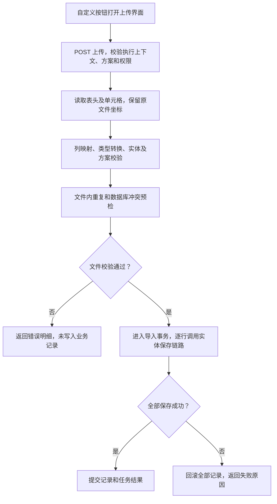

# 实体自定义 Excel 导入导出设计

状态：设计提案，尚未实现业务功能。日期：2026-10-08。

用户已确定导入语义：批量导入实体记录，校验通过后直接保存。接口请求方式统一使用 GET 或 POST；实体只维护导入导出配置，具体入口及方案绑定在已有自定义按钮中实现。本文作为后续开发依据。

## 1. 方案结论

在“实体设计”增加“导入导出”页签，一个实体可维护多套 Excel 方案。每套方案定义列映射、转换格式、附加校验及执行策略。实体配置只负责方案，不创建按钮或维护按钮绑定。

在已有自定义按钮中设置名称、位置、权限和使用条件，并通过 `FORM_BUTTON_CLICK` 事件绑定 Excel 操作及方案稳定编码。方案引用保存在事件使用的接口扩展配置中，按钮自身继续使用现有结构。实体方案可以被多个自定义按钮复用。

导入时一行对应一条实体记录。用户点击“上传并导入”，服务端先校验整个文件，通过后自动保存。可另行点击“仅校验”检查文件；默认导入不增加人工确认步骤，不把数据回填到当前表单，也不提交当前表单里的未保存内容。

第一版采用“仅新增 + 全部成功或全部回滚”。导出支持按方案列顺序生成 XLSX，复用现有实体查询、数据权限和游标分页能力。方案可被多个表单引用，后续列表也可复用。


## 2. 现有能力和需要扩展的部分

| 现有实现 | 本功能如何使用 |
| --- | --- |
| `EntityField` 的类型、必填、唯一、默认值、字典和 `validateRules` | 继承实体规则，Excel 方案仅补充导入格式和更严格的规则 |
| `EntityFieldValidationRuleService` | 执行已有动态字段校验，避免另建一套含义不同的长度、数值和格式规则 |
| `EntityForm.viewConfig.actionBar.customButtons` | 使用已有自定义按钮，继续使用按钮权限、位置和可用条件 |
| `UiEventBinding`、接口扩展及 `UiDataSourceProvider` | 在按钮点击事件中绑定 Excel 操作及方案，读接口返回受控执行上下文 |
| 共享事件 `effects` 分发 | 增加 Excel 操作效果的消费能力，打开上传界面或调用导出、模板接口 |
| `EntityDataActionService` 与实体变更事务链路 | 保存时执行已有权限、默认值、事件、业务约束、唯一性和审计处理 |
| `PublishedFormSubmissionService` | 为每个导入记录应用明确选定的写入表单规则，执行权威提交校验 |
| `EntityDataExportService` | 现有输出是 CSV；复用其中的权限语义和受控查询，在新的 Excel 服务中写 XLSX |
| `CurrentFormRuntimeContext` | 沿用当前发布配置和请求受理边界；补充方案依赖摘要 |
| `workflow-excel` 的监听器、转换器、动态表头和分批写入 | 提供底层文件读写；扩展动态单元格元数据和配置驱动的转换能力 |

现有表单自定义按钮要求绑定 `FORM_BUTTON_CLICK`，其事件接口只允许无副作用的 READ 操作。本设计沿用按钮结构及该约束：注册 Excel 操作准备 Provider，将方案引用配置在接口扩展中，由事件返回受控执行上下文。上传、导入、导出和模板生成由后续 GET/POST 接口完成，实际业务写入不发生在 READ Provider 中。

`ExcelNotBlank` 等注解校验固定 Java DTO。动态实体使用 `Map<String, Object>`，Map 中的 `name` 键不会自动获得这些注解规则。本功能使用实体元数据和方案规则执行动态校验；固定 DTO 导入仍继续使用注解。

## 3. 配置界面

### 3.1 实体中的方案管理

入口：“实体设计 → 导入导出”。列表展示方案编码、名称、导入/导出能力、当前发布状态和引用数量，支持新增、编辑、复制、发布、停用及查看引用。

一套方案的编辑内容：

| 区域 | 设置内容 |
| --- | --- |
| 基本信息 | 稳定编码、名称、说明、允许导入/导出 |
| 文件结构 | Sheet 名称、表头行数、数据起始行、未知列策略 |
| 列映射 | 列标题、可接受的旧标题、实体字段、顺序、导入/导出开关、宽度 |
| 值转换 | 日期格式、时区、金额精度及舍入、文本清理、字典使用代码或名称 |
| 导入规则 | 必须存在的表头、附加必填、附加范围、文件内重复检查 |
| 保存策略 | 仅新增；后续可选按唯一业务键更新或新增/更新 |
| 写入表单 | 选择已发布的写入表单，所有文件行统一应用其提交规则 |
| 导出格式 | 文件名规则、Sheet 名称、显示值或原始代码、列宽 |

例如，“员工基础资料”方案可配置：

| Excel 列 | 实体字段 | 转换 | 校验 |
| --- | --- | --- | --- |
| 工号 | `employeeNo` | 文本，保留前导零 | 必填、文件内唯一、实体唯一 |
| 姓名 | `name` | 去首尾空白 | 必填、继承字段长度 |
| 入职日期 | `joinDate` | `yyyy-MM-dd` | 有效日期 |
| 月薪 | `salary` | 精确十进制，两位小数 | 非负、不允许隐式舍入 |
| 在职状态 | `employmentStatus` | 绑定代码表，名称转代码 | 代码必须存在且可用 |

模板由同一份已发布方案生成，包含输入列、格式说明和必要的字典说明。说明页不参与数据读取。导出可以包含只读列，但导入映射必须限定在允许写入的字段中。

### 3.2 自定义按钮中的绑定

入口：“实体表单 → 表单设置 → 按钮与操作 → 自定义按钮 → 点击事件”。先创建普通自定义按钮，再在事件的主处理步骤选择 Excel 操作准备接口，配置“导入”“导出”或“下载模板”以及对应方案。

按钮面板维护名称、图标、位置、适用模式、权限和可用条件。事件中的接口扩展维护操作、方案编码及导出数据范围。列映射和转换规则统一读取实体方案，不在按钮中复制。

为减少配置步骤，可在自定义按钮的事件编辑器提供 Excel 操作配置区，选择操作和方案后保存对应的接口扩展与事件绑定；不在实体方案编辑器中增加按钮设置，也不自动向表单添加按钮。

第一版引用当前实体的方案，避免按钮悄悄写入其他实体。子实体导入后续通过已发布关系和受控父记录上下文接入。

导入按钮明确显示“批量新增”，导入结果展示新增数量与失败原因。当前页面若是某条记录的编辑页，导入也不会更新这条记录或保存其未提交字段。

表单按钮沿用 `FOOTER` 或 `ACTION_SLOT`，可在表单布局中添加操作区放置这些按钮。导入前不强制验证当前表单，因为当前表单输入不是这次批量新增的数据源。

## 4. 配置结构

### 4.1 实体方案示例

以下是建议协议，字段名称在实现时统一纳入结构校验；`schemaVersion` 是 JSON 协议版本。

```json
{
  "schemaVersion": 1,
  "schemeCode": "employee_basic",
  "name": "员工基础资料",
  "file": {
    "sheetName": "员工资料",
    "headRowNumber": 1,
    "unknownColumnPolicy": "REJECT"
  },
  "importConfig": {
    "enabled": true,
    "writePolicy": "CREATE_ONLY",
    "transactionPolicy": "ATOMIC_ALL",
    "writeFormKey": "employee_create",
    "startProcess": false,
    "maxRows": 1000
  },
  "exportConfig": {
    "enabled": true,
    "fileNamePattern": "员工资料_{yyyyMMddHHmmss}",
    "sheetName": "员工资料"
  },
  "columns": [
    {
      "key": "employee_no",
      "header": "工号",
      "headerAliases": ["员工编号"],
      "fieldCode": "employeeNo",
      "importEnabled": true,
      "exportEnabled": true,
      "requiredHeader": true,
      "codec": { "type": "STRING", "trim": true },
      "validation": { "required": true, "uniqueInFile": true }
    },
    {
      "key": "employee_name",
      "header": "姓名",
      "fieldCode": "name",
      "importEnabled": true,
      "exportEnabled": true,
      "requiredHeader": true,
      "codec": { "type": "STRING", "trim": true },
      "validation": { "required": true }
    },
    {
      "key": "join_date",
      "header": "入职日期",
      "fieldCode": "joinDate",
      "importEnabled": true,
      "exportEnabled": true,
      "codec": {
        "type": "DATE",
        "format": "yyyy-MM-dd",
        "readPatterns": ["yyyy-MM-dd", "yyyy/MM/dd"]
      }
    },
    {
      "key": "salary",
      "header": "月薪",
      "fieldCode": "salary",
      "importEnabled": true,
      "exportEnabled": true,
      "codec": {
        "type": "AMOUNT",
        "scale": 2,
        "roundingMode": "UNNECESSARY",
        "writeAsText": true
      },
      "validation": { "min": "0" }
    },
    {
      "key": "employment_status",
      "header": "在职状态",
      "fieldCode": "employmentStatus",
      "importEnabled": true,
      "exportEnabled": true,
      "codec": { "type": "DICT", "importMode": "LABEL_OR_CODE", "exportMode": "LABEL" }
    }
  ]
}
```

字段类型、数据库列名、字典来源及可写性由服务端读取已发布实体定义。文件不能指定数据库表或列，`DICT` 使用字段绑定的代码表，不接受文件或浏览器临时指定另一张代码表。

同一输入字段只能映射一次。标题与别名不能产生歧义。优先按标题匹配，用户调整 Excel 列顺序仍可导入；遇到重复标题、缺少必需列或未知列时给出明确结果。

必需表头和必填值是不同规则。某字段未出现在文件中可使用可信默认值或编码生成器，但最终记录仍须满足实体和写入表单的必填约束。方案不能将实体必填或唯一约束关闭。

### 4.2 自定义按钮与事件绑定示例

按钮继续使用现有 `type: "custom"`，示例不增加独立 Excel 按钮类型或 `handler` 字段。按钮本身不保存方案编码：

```json
{
  "key": "import_employee",
  "type": "custom",
  "label": "批量新增员工",
  "icon": "Upload",
  "enabled": true,
  "placement": "ACTION_SLOT",
  "slotKey": "employee_tools",
  "modes": ["create", "edit"],
  "perm": "entity:employee:import",
  "validateBeforeExecute": false
}
```

为该按钮配置接口扩展。以下 Provider 编码是本功能拟新增的注册能力，接口定义继续使用现有扩展协议：

```json
{
  "extensionType": "INTERFACE",
  "extensionKey": "employee_import_action",
  "displayName": "员工基础资料导入入口",
  "implementationType": "REGISTERED_PROVIDER",
  "providerCode": "entity_excel_action",
  "scopeType": "FORM",
  "scopeId": "form_employee",
  "interfaceKind": "READ",
  "interfaceContextType": "FORM",
  "implementationConfig": {
    "operation": "IMPORT",
    "schemeCode": "employee_basic"
  }
}
```

按钮点击事件引用上述扩展的 ID：

```json
{
  "ownerType": "FORM",
  "ownerId": "form_employee",
  "targetType": "BUTTON",
  "targetKey": "import_employee",
  "eventCode": "FORM_BUTTON_CLICK",
  "inheritanceMode": "REPLACE",
  "enabled": true,
  "steps": [
    {
      "stepCode": "excel_action",
      "strategy": "REPLACE",
      "extensionId": "ext_employee_import_action",
      "order": 10,
      "inputMapping": {},
      "outputMapping": [],
      "failurePolicy": "STOP"
    }
  ]
}
```

导出按钮使用相同方式绑定 `operation: "EXPORT"`，接口配置可设置 `dataScope` 和 `listKey`；模板按钮绑定 `operation: "TEMPLATE"`。从表单导出 `CURRENT_RECORD` 时使用服务端读取的已保存记录；新增页没有记录 ID 时禁用此选项。批量导出 `SELECTED`、`FILTERED` 必须有合法的已发布列表上下文，使用列表的受控条件与权限。

### 4.3 按钮事件与实际执行的衔接

拟新增 `EXCEL_ACTION` 事件效果，由共享事件运行层分发。例如导入准备接口返回：

```json
{
  "effects": [
    {
      "type": "EXCEL_ACTION",
      "operation": "IMPORT",
      "schemeName": "员工基础资料",
      "actionContextToken": "签名执行上下文"
    }
  ]
}
```

该 READ Provider 只解析已发布绑定、检查入口权限并生成短期签名上下文，不创建导入导出任务、不上传文件、不保存实体记录。前端消费效果：导入打开文件选择与结果界面，导出提交 POST 任务请求，模板通过 POST 下载接口获取文件。

签名上下文至少绑定当前用户、来源表单和按钮、事件及接口发布摘要、方案身份与摘要、允许操作、受控数据范围和过期时间。实际接口校验签名、当前认证用户、绑定有效性及最新权限，重新核对配置摘要；签名上下文不能取代权限校验。文件、选中 ID 和查询条件只作为授权范围内的运行参数，不能覆盖已绑定方案及执行策略。

现有前后端事件效果处理器尚不支持 `EXCEL_ACTION`，实现时扩展效果模型、审计白名单和共享分发器，并提供上传、任务和下载适配。配置为 Excel 操作的按钮必须绑定一条明确的无条件主处理步骤，继续遵守 `FORM_BUTTON_CLICK` 的 READ 约束。

导入成功消息及列表刷新由 Excel 效果处理器收到实际任务成功结果后触发；准备接口执行成功只表示入口已就绪。用户取消文件选择、校验失败或保存失败时，不显示导入成功，也不执行成功后的刷新。

服务端通过“已发布自定义按钮 → 点击事件 → 接口扩展配置”定位方案，不信任客户端临时传入的列、策略、权限码或实体编码。方案不保存 buttonKey、按钮位置或模式等界面配置。

当前标准实体权限尚无 IMPORT，需要增加 `entity:{entityCode}:import` 的动作定义及授权配置。导入同时要求 IMPORT 和实际 CREATE 权限；只校验与模板下载也须经过相应导入入口授权。导出继续使用现有 EXPORT / EXPORT_ALL，按钮自定义权限是附加约束，不能取代标准权限。

## 5. 导入执行



### 5.1 校验顺序

1. 校验文件格式、大小、Sheet、数据行数和表头映射。第一版支持 XLS/XLSX 导入，XLSX 导出，不执行文件内公式、宏或外部引用；输入字段中的公式单元格返回不支持的类型错误。
2. 读取原始单元格并转换为类型值：日期严格解析，金额使用 `BigDecimal`，文本编码保留前导零，字典名称按受控代码表解析。
3. 检查字段是否允许写入，应用可安全预计算的默认值，校验实体基础规则及方案附加规则。缺失的系统生成字段在写入阶段由现有服务生成。
4. 检查文件内重复和已有记录冲突，按批次查询字典、引用和唯一键，避免每个单元格单独查库。
5. 保存时再次执行已有的默认值、提交前处理、表单规则、权限及唯一性终检；预检通过不能替代事务内终检。

“仅校验”只执行无业务副作用的预检。可能调用接口或改变数据的 `BEFORE_SUBMIT`、流程动作及自定义保存事件不在预检时运行；只能在实际导入事务中执行，因此预检通过不承诺后续保存一定成功。

纯空行默认跳过，有部分列有值的行仍须校验。行号使用 Excel 实际行号，不能根据成功行数量推算。单元格错误应尽量收集，表头错误、结构损坏或超过资源上限则立即终止。

### 5.2 保存与事务

第一版只开放 `CREATE_ONLY`，默认不发起流程。每行调用当前实体标准新增链路，绑定方案明确选定的写入表单；来源表单只负责入口，不默认将其编辑/审批规则当作新增规则。

写入表单必须属于当前实体且已发布。方案发布时固定稳定 `formId`，迁移包中以 `entityCode + formKey` 表达跨环境身份，运行时读取当前发布。导入不允许客户端为每行指定不同表单或切换提交策略。

服务端同时校验入口按钮和写入入口的新增权限，不能借批量导入绕过已有 CREATE 按钮、字段可写性或数据范围。如果当前保存链路对这些上下文没有合适的批量入口，应新增共享应用服务入口，继续复用既有权限和变更执行器，不能直接调用 Mapper 绕过规则。

建议第一版限制每文件 1,000 行、5 MiB。这是可调整的产品上限，需要压测后确认；方案可以收紧，不能超过服务端全局上限。解析和预检在写事务外完成，通过后用短事务统一保存，任一行失败则整体回滚。

`ATOMIC_ALL` 的保证涵盖同一业务数据库内的记录、唯一占位、事务事件及任务结果。存在不可回滚的远程调用时不能宣称整次导入完全原子；第一版应通过扩展能力描述检查阻止这类配置，或先将外部副作用改为提交后 Outbox 执行。现有提交链路是否全部满足此条件，需要实现阶段逐入口核查。

导入任务最终成功状态与全部业务写入在同一事务提交。任务状态更新失败也回滚业务写入，避免“记录已保存但任务显示失败”后重复导入。事务回滚后，在独立事务中保存失败报告。

每次执行携带稳定 `requestId`。服务端按用户、入口和 `requestId` 建立唯一执行键，并绑定文件摘要及配置摘要。同一请求重试返回原任务，不重复执行；相同请求 ID 换文件或参数返回冲突。网络重试与用户主动再次导入是不同操作。

后续开放 `MATCH_UPDATE` / `UPSERT` 时，必须指定已发布的唯一业务键。未找到、找到多条、无修改权限、并发版本变化分别返回错误；不能仅凭名称自动猜测目标，也不能泄露无权访问的冲突记录内容。空单元格默认保留已有值，明确清空另设协议。

### 5.3 结果与错误

结果展示文件数据行数、跳过空行数、通过数、失败数和实际新增数。全部回滚时新增数必须为 0，并标明“未保存”。

错误结构建议包含 `sheetName`、一基 `rowNumber`、列标识、`fieldCode`、`header`、`errorCode` 和提示。原始值只在当前用户确有字段读取权限时展示，可按字段敏感性脱敏。

```json
{
  "jobId": "job_xxx",
  "status": "REJECTED",
  "dataRowCount": 120,
  "validRowCount": 118,
  "invalidRowCount": 2,
  "savedRowCount": 0,
  "errors": [
    {
      "sheetName": "员工资料",
      "rowNumber": 8,
      "columnLetter": "B",
      "fieldCode": "name",
      "header": "姓名",
      "errorCode": "REQUIRED",
      "message": "姓名不能为空"
    }
  ]
}
```

错误页分页查询，页面只展示有限条；可下载“原输入值 + 行号 + 错误原因”的报告。错误明细和报告都有数量及大小上限，达到上限明确提示截断，不宣称完整扫描结果。

## 6. 导出执行

导出数据范围由自定义按钮点击事件中已发布的接口扩展配置确定，或在其允许范围内选择：

| 范围 | 数据来源与权限 |
| --- | --- |
| `CURRENT_RECORD` | 按记录 ID 从服务端读取当前已保存数据，检查查看及单条导出权限 |
| `SELECTED` | 按选中 ID 查询，逐条检查导出能力；存在不可导出记录时整体拒绝 |
| `FILTERED` | 已发布列表条件与用户输入条件、数据权限取交集，执行全量导出权限 |

所有范围都执行字段读取权限。方案中包含用户无权读取的列时，明确拒绝执行并给出可修复提示，不能通过方案额外取出字段。

按照方案中的 `exportEnabled` 和列顺序构造动态表头，按批次写出。复用现有游标查询；如方案列不在列表显示投影中，应扩展受控查询投影，不能假定旧列表返回的 DTO 已含全部所需字段。

日期、金额和代码按方案格式输出。大整数、编码和高精度金额默认按文本保真；声明输出为数值时执行精度检查。固定文本与计算列可在后续通过受控列提供器扩展，不开放任意 SQL、脚本或类名。

生成文件先写到任务临时对象，完整成功后标记为可下载；失败丢弃部分文件。游标查询提供有界分页，不自动保证多个批次的数据快照一致性。需要某个时刻的严格快照时，另行设计查询快照能力。

## 7. 发布、引用和配置变更

方案采用“草稿 + 当前已发布配置”，草稿编辑不影响运行，发布后通过事件引用它的自定义按钮读取当前方案。编码进入引用后保持稳定，修改名称不改变引用。

方案稳定身份保存在按钮事件使用的接口扩展配置中，不提供方案业务版本选择。与当前表单发布语义一致：方案重新发布后，无需逐张表单重新发布才能使用新列映射。修改按钮的事件绑定或更换方案时，仍需发布所属表单。

需要扩展发布引用检查和运行摘要：

- 表单发布沿自定义按钮事件及固定接口定义检查引用方案存在、已发布、实体归属正确，且绑定操作已启用。
- 方案发布检查字段、写入表单、字典及列表引用有效；不能发布无法执行的配置。
- 实体字段删除或类型变化、写入表单删除、方案删除均检查当前发布引用。对未发布草稿中的失效引用标红，并阻止后续发布。
- 现有表单依赖摘要只覆盖根表单和子表单，需要识别按钮事件中的 Excel 接口扩展引用，增加方案配置摘要及相关写入表单摘要。导入任务另保存实际采用的实体发布身份和 schemaHash。
- 单次执行受理时核对客户端的预期摘要，页面配置过期返回 `409 EXCEL_CONFIGURATION_CHANGED`。任务受理后使用同一份不可变执行计划，避免逐行切换方案和规则。
- 长任务中的权限、目标数据和唯一性仍在写入时核查。结构性实体变更需与现有实体发布/变更锁协调，不能在旧执行计划上写入不兼容的新表结构。

方案与写入表单的解析要复用同一批量执行上下文，而不能依赖 HTTP 请求级缓存覆盖未来异步 Worker。配置快照只用于任务审计和已受理执行，不作为历史业务版本选择入口。

写入表单引用是执行上下文，不是自动嵌套。一个表单可以引用某方案并同时作为该方案的写入表单；摘要按带类型的稳定身份去重，不能将这类引用误判为自动包含循环。实体保存只调用写入表单的提交链路，不再次触发其导入按钮。

## 8. 后端职责与扩展点

| 模块 | 建议职责 |
| --- | --- |
| `workflow-excel` | 原始单元格读取、文件坐标、格式转换、动态表头、流式写入、通用错误模型 |
| `workflow-entity` | 方案管理、发布解析、Excel 操作准备 Provider、执行上下文校验、动态字段校验、任务编排、实体保存和查询 |
| `workflow-spi` | 后续业务值解析、纯导入规则、导出计算列的稳定扩展契约 |
| `workflow-storage` / 现有存储 SPI | 导入原文件、结果文件和错误报告的私有存储及授权下载 |
| `workflow-db-migrator` | 后续新增方案和任务表迁移 |
| `workflow-web` / 共享运行包 | 实体方案编辑器、自定义按钮事件中的方案绑定、Excel 事件效果分发、上传与结果展示 |

`workflow-excel` 保持通用，不依赖实体、权限或 Servlet。当前 `Map<Integer, String>` 动态读取会丢失部分原生单元格信息，建议新增原始单元格接口，至少保留值、类型、显示格式、坐标和工作簿日期基准。原有字符串接口保留兼容。

建议将日期、文本、金额的转换核心提取为可通过普通参数调用的 `ExcelValueCodec`，现有注解 Converter 与动态配置共用转换规则。动态字典和人员/部门/实体引用由业务层批量查询后传入解析上下文，不能在 Excel 基础模块内查业务数据库。

建议业务层类：`EntityExcelSchemeService`、`EntityExcelActionProvider`、`EntityExcelRuntimeResolver`、`EntityExcelImportService`、`EntityExcelDynamicValidator`、`EntityExcelExportService`、`EntityExcelJobService`。`EntityExcelActionProvider` 实现现有 `UiDataSourceProvider`，返回操作准备结果。

后续扩展点：

- `EntityExcelValueResolverProvider`：将授权范围内的人员、部门、实体业务编码转换为实际值；名称匹配不唯一时报错。
- `EntityExcelImportRuleProvider`：纯校验跨列、跨行业务规则，返回结构化错误，预检时不产生副作用。
- `EntityExcelExportColumnProvider`：提供声明字段依赖的计算列，依赖字段同样受读取权限控制。

扩展通过服务端注册编码与参数协议选择，不能配置任意 Java 类名或直接执行脚本。第一版通用导入仅支持 DYNAMIC 实体；SYSTEM 实体仍沿用其专用写入规则，不能直接调用通用新增入口写系统表。

## 9. 存储和接口草案

### 9.1 存储模型

建议新增以下逻辑表，实际列和索引在实现时结合项目约定细化：

| 表 | 用途 |
| --- | --- |
| `entity_excel_scheme` | 稳定实体归属、编码、草稿 JSON、revision 和管理状态；实体内编码唯一 |
| `entity_excel_scheme_published` | 每方案一份当前发布 JSON、contentHash、发布人及时间 |
| `entity_excel_job` | 类型、用户、来源按钮、文件摘要、受理配置、幂等键、状态、数量及结果文件身份 |
| `entity_excel_job_row` | 有界的暂存转换值、原始行号、错误和执行结果；用于预检报告与事务保存 |

配置 JSON 保存列明细，第一版不必单独创建列映射表。暂存行及原文件默认 24 小时后清理，长期审计仅保留必要元数据，保留期按项目规则设置。任务文件通过任务归属授权下载，不能直接暴露公共文件 URL。

按钮和方案的绑定使用已有 `ui_event_binding` 与接口扩展定义存储，不新增实体方案到按钮的专用绑定表。引用查询与删除保护应检查草稿及当前发布事件中的接口定义，不能只扫描 `customButtons`。

本次只给出模型，没有新增迁移。实现时重新检查最大 Flyway 版本再创建新迁移，不预占版本号，不修改已有 V* 文件。

### 9.2 接口

沿用项目现有路由前缀和 `ApiResponse` 封装。所有接口只使用 GET 和 POST：GET 查询列表、详情、引用和已生成结果；POST 保存、发布、停用、删除及文件处理。以下为接口草案。

| 方法与路径 | 用途 |
| --- | --- |
| `GET /entities/{entityCode}/excel-schemes` | 方案分页列表 |
| `GET /entities/{entityCode}/excel-schemes/{schemeCode}` | 读取草稿及当前发布摘要 |
| `POST /entities/{entityCode}/excel-schemes/save` | 新增或更新方案；更新携带 ID 和 expectedRevision |
| `POST /entities/{entityCode}/excel-schemes/{schemeCode}/publish` | 携带预期 revision/contentHash 发布当前草稿 |
| `POST /entities/{entityCode}/excel-schemes/{schemeCode}/status` | 启用或停用方案 |
| `GET /entities/{entityCode}/excel-schemes/{schemeCode}/references` | 查看引用 |
| `POST /entities/{entityCode}/excel-schemes/{schemeCode}/delete` | 通过引用检查后删除 |
| `POST /entity-excel/templates/download` | 校验自定义按钮执行上下文并生成、下载模板 |
| `POST /entity-excel/import-checks` | Multipart 上传并创建只校验任务 |
| `POST /entity-excel/imports` | Multipart 上传、全量校验、直接保存 |
| `POST /entity-excel/exports` | 创建授权导出任务 |
| `GET /entity-excel-jobs/{jobId}` | 查看任务结果 |
| `GET /entity-excel-jobs/{jobId}/errors` | 分页查看错误 |
| `GET /entity-excel-jobs/{jobId}/files/{fileKind}` | 下载授权范围内的结果或错误报告 |

自定义按钮绑定保存和点击事件执行沿用项目已有 POST 接口；方案绑定由接口扩展定义和事件步骤保存，不另增表单 Excel 按钮保存接口。

Excel 运行请求携带 `actionContextToken`、requestId、文件或允许的选中 ID/查询条件。方案与来源身份由服务端从签名上下文和已发布事件绑定解析，不在 URL 中重复建立表单到方案的配置关系。上下文令牌放在 POST 请求体或 Multipart 字段中，避免放入下载 URL；GET 任务查询及下载仍要求当前认证用户具有任务访问权限。

任务创建响应返回任务 ID 和状态，任务内的行错误作为执行结果读取。入口参数错误、权限拒绝、大小超限、配置或幂等冲突分别使用现有项目规范对应的 4xx；后端异常使用 5xx 并记录任务失败。

第一版在有界文件内同步执行，响应返回已完成任务；接口和状态模型预留后续异步执行返回 `202` 的能力，异步 Worker 必须接收显式受理配置、用户授权上下文及幂等键，不能依赖请求线程状态。

## 10. 开发顺序与验收

1. 增加原始单元格模型、动态值转换和动态规则校验能力；保持现有 DTO 注解导入兼容。
2. 增加实体方案管理、当前发布、引用检查及模板下载。
3. 增加导入任务、完整文件校验、CREATE_ONLY 原子保存、错误报告与幂等。
4. 增加方案驱动的 XLSX 导出，复用受控游标查询。
5. 注册 Excel 操作准备 Provider，在已有自定义按钮点击事件中配置方案引用；扩展共享事件效果分发，接入上传、结果与下载界面。

必须覆盖的验收场景：

- 列重排、标题别名、重复/缺少表头、空行及原始行号；解析受资源限制。
- 前导零、大整数和金额精度不丢失，1900/1904 日期基准正确；公式输入拒绝执行。
- 动态必填、字段规则、字典校验、文件内重复及并发唯一冲突生效。
- 单行保存失败时整个导入回滚，外部副作用按明确事务能力处理。
- 网络重试、同时执行相同 requestId、写入后进程退出不会重复保存。
- 导入逐行新增权限和写入表单规则生效，不能借修改请求写系统字段或其他实体。
- 导出当前记录、选中、筛选的权限及字段范围正确，分页不累计全部记录。
- 方案和写入表单重新发布后，旧摘要请求被拒绝；已受理执行使用一致配置。
- 全部接口仅使用 GET/POST，查询接口不产生实体写入或触发导出任务。
- 实体方案配置不保存按钮信息；自定义按钮使用既有事件绑定，READ 准备接口不产生业务副作用。
- 执行上下文与用户、按钮、方案及操作一致，篡改或跨用户重放被拒绝；实际执行重新检查权限。
- 原有普通事件按钮和现有 CSV 导出保持兼容。

第一版完成后再扩展按唯一键更新、大文件后台执行、关系子表、多 Sheet、多语言标题和复杂业务计算列；这些能力各自需要明确的数据范围与保存协议。
